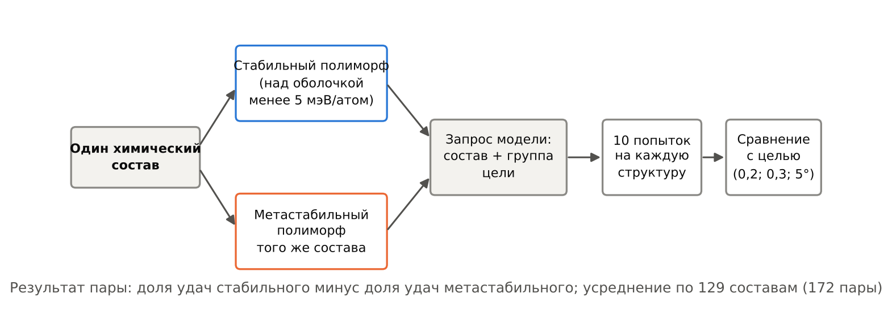
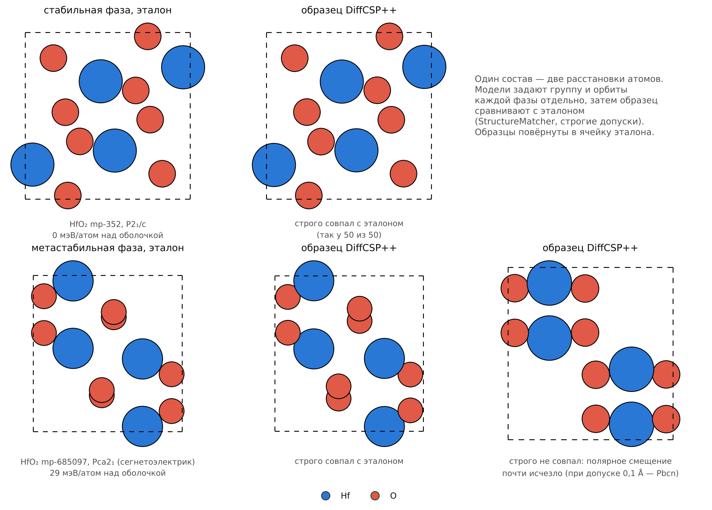
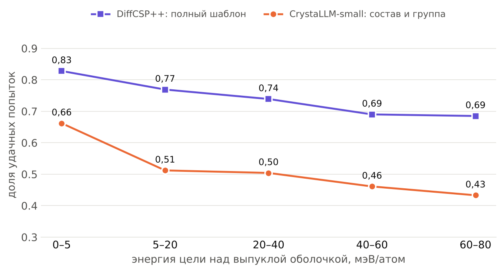
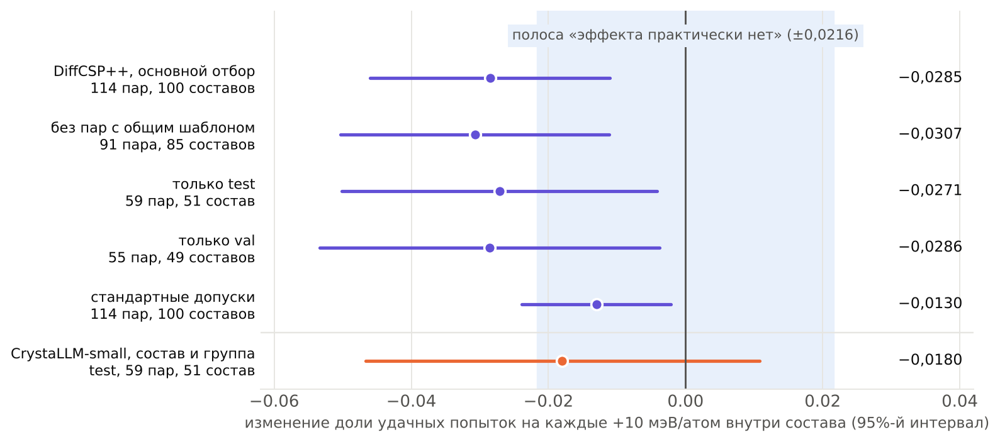
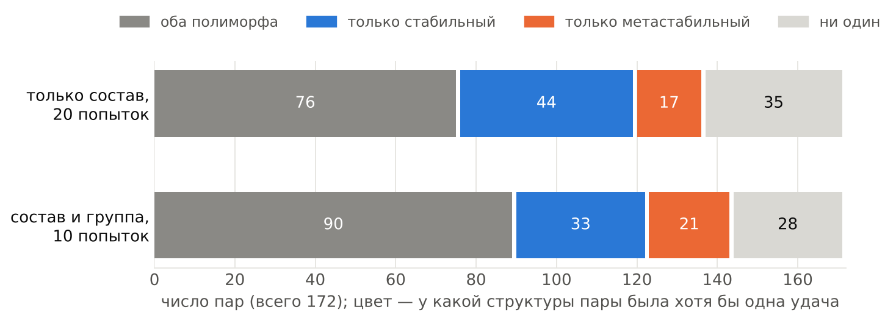
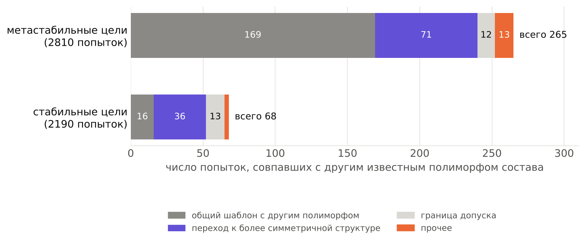
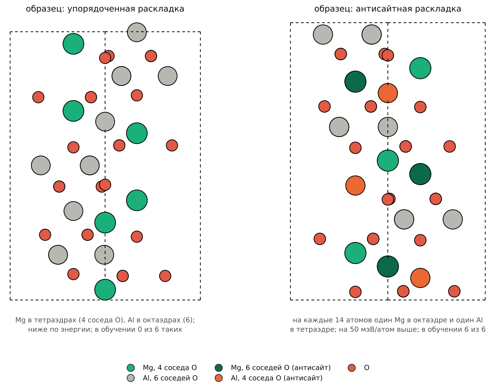
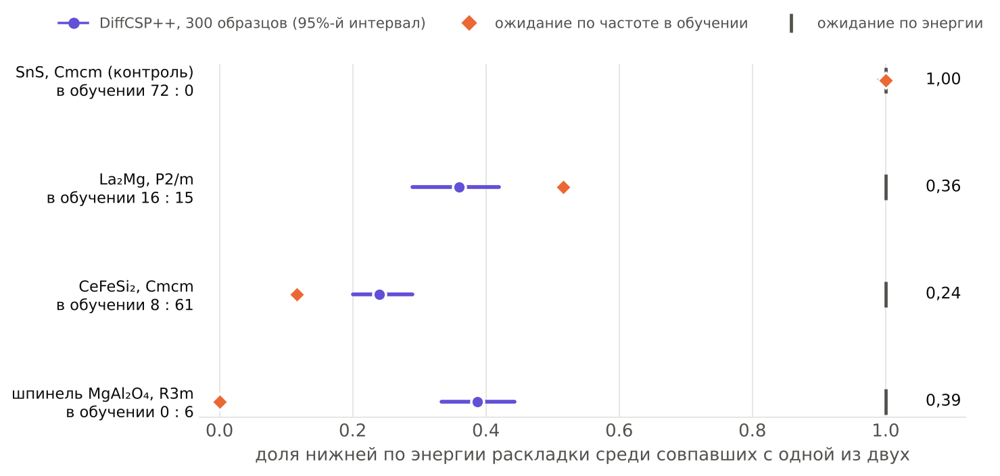

# Гипотеза 1. Зависимость точности условной генерации кристаллов от метастабильности целевой фазы

## 1. Цель работы

Оценивается, воспроизводит ли генеративная модель с условием на пространственную группу метастабильный полиморф реже, чем стабильный полиморф того же состава, и если да, то связано ли это с энергией полиморфа или с другими его свойствами (сложность шаблона, покрытие обучающей выборки структурами того же типа, принадлежность к обучающей выборке). Задача по типу — диагностика условной генеративной модели на открытом бенчмарке.

Объекты исследования: DiffCSP++ (диффузионная модель предсказания кристаллической структуры, обусловленная составом, группой и орбитами Вайкоффа; жёсткое условие) и CrystaLLM-small (языковая модель текстового представления CIF, чекпоинт `cif_model_mp_20_b`, обучена на обучающей части MP-20; условие мягкое: состав ячейки и, необязательно, символ группы в запросе); тестовая и обучающая части MP-20 — структуры не более чем из 20 атомов в примитивной ячейке с энергией над выпуклой оболочкой от 0 до 0,08 эВ/атом; отдельные фазы — полиморфы HfO₂ и ZrO₂, включая полярные Pca2₁ (mp-685097, mp-556605).

Формулировка с учётом полученных результатов. Между составами доля воспроизведения у CrystaLLM-small падает с ростом энергии над выпуклой оболочкой, и спад сосредоточен на переходе от почти стабильных (менее 5 мэВ/атом) к метастабильным целям; учёт покрытия этот спад не снимает. У DiffCSP++ с полным шаблоном спад между составами объясняется сложностью шаблона и покрытием обучающей выборки. Внутри одного состава при запросе без группы средняя разность долей между стабильным и метастабильным полиморфом мала и почти целиком приходится на пары, в которых шаблон метастабильного полиморфа сложнее. Предполагается, что при фиксированном составе, явно заданной группе и сопоставимой сложности шаблона (число свободных координат у двух полиморфов отличается не более чем на 2) изменение доли воспроизведения на каждые +10 мэВ/атом лежит в границах ±0,0216 (на диапазоне 0–0,08 эВ/атом шансы меняются не более чем вдвое), а промахи по метастабильным целям не замещаются стабильным полиморфом того же состава чаще, чем промахи по стабильным целям — другим полиморфом.

## 2. Основные предположения

1. Обучающая выборка MP-20 смещена к структурам, близким к равновесию: средняя энергия над выпуклой оболочкой равна $0{,}017$ эВ/атом, медиана $0{,}0035$, третий квартиль $0{,}030$, максимум $0{,}080$ эВ/атом.
2. Вероятность воспроизведения связана с покрытием обучающей выборки структурами того же типа $n^{\text{тип}}$, со сложностью шаблона $n^{\text{своб}}$ и с принадлежностью цели к обучающей выборке $T$ (по бенчмарку DiffCSP++: ОШ $6{,}9$ на стандартное отклонение $\ln(1+n^{\text{тип}})$ и ОШ $2{,}5$–$2{,}7$ для $T=1$). Частота прототипа $n^{\text{прот}}$ служит грубым индикатором покрытия. У $0{,}3\%$ целей тестовой части в обучающей выборке есть почти дубликат той же химии, у $87{,}6\%$ — хотя бы одна структура того же типа.
3. Энергия цели связана с покрытием и сложностью: медиана $n^{\text{прот}}$ по корзинам энергии падает от $55$ до $15{,}5$, корреляция энергии с $n^{\text{своб}}$ около $0{,}2$. Оценка эффекта энергии без этих контролей смещена.
4. Функциональные фазы нередко метастабильны на масштабе $0{,}02$–$0{,}03$ эВ/атом (Pca2₁ в HfO₂: $0{,}029$ эВ/атом).
5. Энергия над выпуклой оболочкой — энергия структуры относительно выпуклой оболочки в пространстве составов. Для двух полиморфов одного состава оболочка общая, поэтому разность их энергий над оболочкой равна разности полных энергий. Разность между составами дополнительно отражает устойчивость самого соединения, поэтому эффекты на двух уровнях не обязаны совпадать.
6. Диапазон разностей внутри состава ограничен базой: в тестовой части $377$ составов имеют не менее двух структур ($889$ структур), медианный разброс энергии над выпуклой оболочкой внутри состава $16{,}3$ мэВ/атом; составов, где есть и почти стабильный, и метастабильный полиморф, после проверки группы при допуске $0{,}1$ Å осталось $129$ ($172$ пары, в наборе `pairs_v1` $303$ структуры), медианная разность энергий в паре $27$ мэВ/атом.
7. Сложность шаблона полиморфов одного состава часто различается: в $60$ из $172$ пар у метастабильного полиморфа больше свободных координат, в $72$ — меньше, в $40$ — столько же. Связь успеха с $n^{\text{своб}}$ нелинейна (у DiffCSP++ доля совпадений $0{,}98$–$1{,}00$ при $n^{\text{своб}}\leq4$ и $0{,}44$ при $n^{\text{своб}}\geq9$), поэтому линейный контроль $n^{\text{своб}}$ её не снимает, и пары нужно разделять по разности сложности.
8. При запросе только с составом у полиморфов с одинаковым числом атомов в ячейке запрос одинаков, и их попытки — выборки из одного распределения модели по структурам этого состава ($85$ пар из $172$).
9. У $20$ из $129$ составов набора пар ещё более низкий по энергии полиморф лежит в обучающей или валидационной части; у HfO₂ и ZrO₂ стабильная фаза P2₁/c лежит в обучающей части, поэтому сравнение фаз этих составов смешивает энергию и принадлежность к обучающей выборке.
10. Шаблон не всегда однозначно задаёт структуру: в MP-20 есть $421$ группа «состав, шаблон» ($327$ составов), в которой хотя бы два полиморфа с одинаковым шаблоном не совпадают по `StructureMatcher`. Для таких целей условие не различает полиморфы, и совпадение с другим полиморфом может быть следствием условия, а не модели; в наборах пар с $n^{\text{своб}} \geq 1$ это $56$ из $500$ целей, из них $40$ метастабильных.

## 3. Структура модели / добавляемые фичи

Модели используются без изменения архитектуры и без дообучения: для DiffCSP++ условие — состав, группа, орбиты Вайкоффа с видами атомов (предобученный чекпоинт MP-20); для CrystaLLM-small — запрос из состава ячейки либо из состава и символа группы. Вводятся следующие величины.

Исход попытки $k$ для цели $i$ — индикатор совпадения с эталоном по `StructureMatcher` (приведение к примитивной ячейке, нормировка объёма) со строгими допусками $(0{,}2;\ 0{,}3;\ 5^\circ)$:

$$
M_{ik} = \mathbb{1}\left[\,\text{StructureMatcher}(s_{ik},\, s_i^{\text{эт}})\,\right], \qquad \hat p_i = \frac{1}{K}\sum_{k=1}^{K} M_{ik}, \qquad H_i = \mathbb{1}\left[\sum_{k} M_{ik} > 0\right],
$$

где $K$ — число попыток на цель, $\hat p_i$ — доля удачных попыток, $H_i$ — цель воспроизведена хотя бы раз. Для сопоставимости с протоколом CDVAE/DiffCSP дополнительно считается $M^{\text{станд}}$ с допусками $(0{,}3;\ 0{,}5;\ 10^\circ)$; для мягкого условия — индикаторы верного состава $C_{ik}$ и верной группы $G_{ik} = \mathbb{1}\left[\text{SG}(s_{ik}, 0{,}1) = g_i\right]$.

Категория попытки по перекрёстному сопоставлению со всеми полиморфами состава в MP-20 (train, val, test):

$$
Q_{ik} \in \{\text{цель},\ \text{другой полиморф},\ \text{новая структура},\ \text{другой состав},\ \text{невалидный CIF}\},
$$

сначала со строгими, затем со стандартными допусками; для категории «другой полиморф» записываются его энергия над выпуклой оболочкой и часть MP-20.

Модель между составами:

$$
\mathrm{logit}\,\Pr(M_{ik}=1) = \beta_0 + \beta_E\,\frac{E_i}{0{,}01} + \gamma_1 \ln\left(1+n^{\text{гр}}_i\right) + \gamma_2\, n^{\text{ат}}_i + \gamma_3\, n^{\text{своб}}_i + \gamma_4 \ln\left(1+n^{\text{прот}}_i\right) + \gamma_5 \ln\left(1+n^{\text{тип}}_i\right) + \gamma_T T_i,
$$

где $E_i$ — энергия цели над выпуклой оболочкой (эВ/атом), $n^{\text{гр}}_i$ — число структур обучающей выборки с группой $g_i$, $n^{\text{ат}}_i$ — число атомов в ячейке, $n^{\text{прот}}_i$ — число структур обучающей выборки с той же анонимизированной формулой и группой, $n^{\text{тип}}_i$ — число структур обучающей выборки того же прототипа, совпадающих с целью по `StructureMatcher` при допущении замены элементов (не более $400$ кандидатов на прототип), $T_i = 1$ для целей из обучающей выборки; для таких целей сама цель исключается из счётчиков. Контрольные переменные стандартизованы, стандартные ошибки кластеризуются по цели. Ступенчатый вариант добавляет $\beta_S S_i$, $S_i = \mathbb{1}\left[E_i \geq 0{,}005\right]$.

Модель внутри состава $c$ с полиморфами $i \in c$:

$$
\hat p_{ic} = \alpha_c + \beta^{\text{внутр}}\,\frac{E_{ic}}{0{,}01} + \sum_j \gamma_j^{\text{внутр}}\, z_{ijc} + \varepsilon_{ic},
$$

где $\alpha_c$ — фиксированный эффект состава, $z_{ijc}$ — те же контрольные переменные; оценка внутригрупповая, стандартные ошибки кластеризованы по составу. Границу эквивалентности $\left|\ln\mathrm{ОШ}\right| \leq \delta$, $\delta = \left|\ln 0{,}917\right| = 0{,}0866$, переводим в доли приближением $\delta_p = \delta\,\bar p\,(1-\bar p) \approx 0{,}0216$ при $\bar p = 0{,}5$. Логистический вариант со стратой по составу (условная логистическая регрессия) — для набора с $K \geq 10$.

Парное сравнение для составов, у которых есть и почти стабильный ($E < 0{,}005$ эВ/атом), и метастабильный ($E \geq 0{,}005$ эВ/атом) полиморф: в паре $j$ берётся самый низкий по энергии почти стабильный полиморф $s(j)$ и один из метастабильных $m(j)$,

$$
\Delta_j = \hat p_{s(j)} - \hat p_{m(j)}, \qquad \Delta_j^{H} = H_{s(j)} - H_{m(j)}, \qquad \Delta n^{\text{своб}}_j = n^{\text{своб}}_{m(j)} - n^{\text{своб}}_{s(j)},
$$

средние по парам и их ДИ — бутстрэп по составам (пары одного состава зависимы). Страты по сложности фиксируются до новых прогонов: сопоставимые ($\left|\Delta n^{\text{своб}}_j\right| \leq 2$), метастабильный сложнее ($\Delta n^{\text{своб}}_j > 2$), метастабильный проще ($\Delta n^{\text{своб}}_j < -2$).

Доля замещения стабильным полиморфом для метастабильной цели $m$ и доля замещения другим полиморфом для стабильной цели $s$:

$$
R_m = \frac{1}{K}\sum_k \mathbb{1}\left[Q_{mk} = \text{другой полиморф},\ E_{\text{найд}} < E_m\right], \qquad R_s = \frac{1}{K}\sum_k \mathbb{1}\left[Q_{sk} = \text{другой полиморф}\right].
$$

Число свободных координатных параметров шаблона:

$$
n^{\text{своб}} = \sum_{o}\left(3 - \operatorname{rk}\begin{pmatrix} R_{o,1}-I \\ \vdots \\ R_{o,m_o}-I \end{pmatrix}\right),
$$

где сумма идёт по орбитам Вайкоффа, $R_{o,j}$ — вращательные части операций группы позиции представителя орбиты $o$.

Окно допуска симметрии (косвенная мера амплитуды искажения):

$$
\tau(s, g) = \max\left\{\varepsilon \in \mathcal{E} :\ \text{SG}(s, \varepsilon') = g\ \ \forall\, \varepsilon' \in \mathcal{E},\ \varepsilon' \leq \varepsilon\right\},
$$

где $\mathcal{E}$ — логарифмическая сетка из 25 значений от $0{,}001$ до $0{,}5$ Å. Недо-искажение образца относительно эталона: $U_i = \mathbb{1}\left[\tau(s_i, g_i) < \tfrac{1}{2}\,\tau(s_i^{\text{эт}}, g_i)\right]$.

## 4. Проверки внутри гипотезы

*Рис. 1. Схема парного сравнения: один состав, два полиморфа, один и тот же запрос с группой цели, по 10 попыток на структуру.*

{.big}

*Рис. 2. Пример пары: эталоны двух фаз HfO₂ и образцы DiffCSP++, выровненные по ячейке эталона.*

Для каждой проверки указан статус по уже полученным данным.

**Проверка 1 (условие выполняется).** Для DiffCSP++ доля попаданий в целевую группу при допуске $0{,}01$ Å $h(0{,}01) \geq 0{,}98$; для CrystaLLM-small доля верной группы при группе в запросе не ниже, чем без неё. *Статус:* выполнено для обеих моделей (CrystaLLM-small: $0{,}90$–$0{,}98$ с группой против $0{,}58$–$0{,}78$ без группы).

**Проверка 2 (принадлежность к обучающей выборке).** $H_0:\ \gamma_T = 0$ против $H_1:\ \gamma_T > 0$. *Статус:* $H_0$ отклонена для DiffCSP++ (ОШ $2{,}52$ [$1{,}40$; $4{,}54$], строгие допуски, $n^{\text{своб}} \geq 1$; при учёте $n^{\text{тип}}$ ОШ $2{,}66$). *Статус (DiffCSP++, $K=10$, по $300$ целей обучающей и тестовой частей, $n^{\text{своб}} \geq 1$):* ОШ $1{,}89$ [$1{,}58$; $2{,}26$]; зависимости от энергии нет ни на тестовых целях ($1{,}015$ [$0{,}970$; $1{,}062$] на $+10$ мэВ/атом), ни на обучающих ($1{,}038$ [$0{,}980$; $1{,}098$]), взаимодействие энергии с принадлежностью $1{,}011$ [$0{,}942$; $1{,}085$].

**Проверка 3 (между составами).** Эквивалентность $\exp\beta_E$ границам $[0{,}917;\ 1{,}090]$ по 90%-му ДИ. *Статус (набор `test3k`: $3000$ целей тестовой части, по $600$ в корзине энергии, $K=3$; $2460$ целей с $n^{\text{своб}} \geq 1$ из $2340$ составов; полные контроли, строгие допуски):* для DiffCSP++ с полным шаблоном ОШ $0{,}980$ [$0{,}942$; $1{,}021$], 90%-й ДИ [$0{,}948$; $1{,}014$] — эквивалентность принята; без контролей $0{,}904$ [$0{,}875$; $0{,}934$], с $n^{\text{своб}}$ и $n^{\text{ат}}$ $0{,}957$ [$0{,}921$; $0{,}994$]. Для CrystaLLM-small с группой в запросе ОШ $0{,}926$ [$0{,}895$; $0{,}959$], 90%-й ДИ [$0{,}900$; $0{,}953$] — не принята. При стандартных допусках и на всех $3000$ целях решения те же. Отношение наклонов DiffCSP++ к CrystaLLM-small на одних и тех же целях $1{,}048$ [$0{,}998$; $1{,}099$]. Ранее: CrystaLLM-small без группы на всём test $0{,}890$ [$0{,}873$; $0{,}908$]; DiffCSP++ на $300$ целях при $K=1$ $1{,}057$ [$0{,}899$; $1{,}242$], вывод был невозможен.

*Рис. 3. Набор `test3k`, $2460$ целей с $n^{\text{своб}}\geq1$: доля удачных попыток по корзинам энергии цели над выпуклой оболочкой для двух моделей.*

**Проверка 4 (разведочная; полярные цели).** Доля недо-искажённых образцов среди полярных целей не выше, чем среди неполярных, точный критерий Фишера. *Статус:* для DiffCSP++ доля выше у полярных ($6/57$ против $3/184$, $p = 0{,}0064$); на совпадение по StructureMatcher полярность при контролях не влияет (ОШ $0{,}97$ [$0{,}29$; $3{,}25$]).

**Проверка 5 (покрытие).** Добавление $\ln(1+n^{\text{тип}})$ сдвигает оценку $\beta_E$ к нулю. *Статус:* для CrystaLLM-small оценка почти не меняется ($0{,}894 \to 0{,}890$), то есть покрытие спад по энергии между составами не объясняет.

**Проверка 6 (основная; внутри состава при явно заданной группе).**

$$
H_0:\ \left|\beta^{\text{внутр}}\right| \geq \delta_p \quad\text{против}\quad H_1:\ \left|\beta^{\text{внутр}}\right| < \delta_p, \qquad \delta_p = 0{,}0216,
$$

два односторонних критерия, $\alpha = 0{,}05$ каждый (90%-й ДИ для $\beta^{\text{внутр}}$ лежит в $[-\delta_p;\ \delta_p]$), отдельно в страте сопоставимой сложности и на всём наборе пар, режим «состав + группа» для CrystaLLM-small и полный шаблон для DiffCSP++, $n^{\text{своб}} \geq 1$. *Статус:* для CrystaLLM-small с группой в запросе ($K=10$, набор `pairs_v1`, $129$ составов) эквивалентность не принята ни в одном варианте модели: без контролей $-0{,}0180$ [$-0{,}0392$; $+0{,}0032$], 90%-й ДИ [$-0{,}0358$; $-0{,}0002$]; с $n^{\text{своб}}$, $n^{\text{ат}}$ $-0{,}0281$ [$-0{,}0484$; $-0{,}0078$], 90%-й ДИ [$-0{,}0451$; $-0{,}0110$]; с полными контролями $-0{,}0234$ [$-0{,}0387$; $-0{,}0082$], 90%-й ДИ [$-0{,}0362$; $-0{,}0106$]. При контролях оценка отрицательна, а 95%-й ДИ не содержит нуля. Эти оценки посчитаны по всем структурам пар, включая структуры с $n^{\text{своб}} = 0$. В отборе, заданном этой проверкой (у обоих полиморфов $n^{\text{своб}} \geq 1$, $\left|\Delta n^{\text{своб}}\right| \leq 2$; $59$ пар, $51$ состав), оценка с полными контролями $-0{,}0180$ [$-0{,}0467$; $+0{,}0108$], 90%-й ДИ [$-0{,}0421$; $+0{,}0062$], без контролей $-0{,}0020$ [$-0{,}0384$; $+0{,}0344$]: результат неопределённый, ни ноль, ни наклон $-0{,}03$ не исключены. В парах, где у одного из полиморфов $n^{\text{своб}} = 0$ ($43$ пары), оценка $-0{,}0393$ [$-0{,}0683$; $-0{,}0103$]. Без пар, где шаблон одного из полиморфов общий с другим полиморфом того же состава ($36$ из $172$ пар), по основному отбору $-0{,}0159$ [$-0{,}0549$; $+0{,}0231$] ($44$ пары, $41$ состав), средняя разность долей $-0{,}091$. *Статус (DiffCSP++, полный шаблон, $K=10$; план разбора зафиксирован до генерации в `docs/analysis_plan_diffcsp_pairs.md`):* в основном отборе на тестовых и валидационных парах ($114$ пар, $100$ составов) с полными контролями $-0{,}0285$ [$-0{,}0460$; $-0{,}0110$], 90%-й ДИ [$-0{,}0432$; $-0{,}0139$]: эквивалентность не принята, 95%-й ДИ целиком ниже нуля, то есть при сопоставимой сложности шаблона метастабильный полиморф воспроизводится реже. Без контролей $-0{,}0292$ [$-0{,}0469$; $-0{,}0116$]. Без пар с общим шаблоном ($91$ пара, $85$ составов) $-0{,}0307$ [$-0{,}0503$; $-0{,}0111$]; отдельно на тестовой части $-0{,}0271$ [$-0{,}0501$; $-0{,}0042$], на валидационной $-0{,}0286$ [$-0{,}0534$; $-0{,}0038$]; при стандартных допусках $-0{,}0130$ [$-0{,}0239$; $-0{,}0021$]. По всем структурам набора ($242$ пары, $189$ составов) $-0{,}0251$ [$-0{,}0370$; $-0{,}0131$]. *Статус (CrystaLLM-small с группой, $K=10$, те же $114$ пар тестовой и валидационной частей):* $-0{,}0173$ [$-0{,}0354$; $+0{,}0008$], 90%-й ДИ [$-0{,}0325$; $-0{,}0021$] — эквивалентность не принята, результат неопределённый; без контролей $-0{,}0252$ [$-0{,}0465$; $-0{,}0040$]. Разность наклонов DiffCSP++ и CrystaLLM-small на одних и тех же $214$ структурах $-0{,}0112$ [$-0{,}0354$; $+0{,}0130$] (разведочно). В режиме без группы: на всех $377$ составах $-0{,}0044$ [$-0{,}0175$; $+0{,}0086$] (эквивалентность принята), на наборе `pairs_v1` ($303$ структуры, составы с почти стабильным полиморфом) $-0{,}0140$ [$-0{,}0309$; $+0{,}0029$], 90%-й ДИ [$-0{,}0282$; $+0{,}0002$] (эквивалентность не принята).

*Рис. 4. Изменение доли удачных попыток на $+10$ мэВ/атом внутри состава, 90%-й ДИ; голубая полоса — границы эквивалентности $\pm0{,}0216$.*

*Рис. 5. DiffCSP++ с полным шаблоном на $114$ парах тестовой и валидационной частей: изменение доли удачных попыток на $+10$ мэВ/атом внутри состава, 95%-й ДИ, основной отбор и вторичные варианты; оранжевый — CrystaLLM-small с группой в запросе на тех же парах.*

**Проверка 7 (парное сравнение по стратам сложности).** В каждой страте $H_0:\ \bar\Delta = 0$ против $H_1:\ \bar\Delta > 0$; 95%-й ДИ — бутстрэп по составам ($B = 3000$); дополнительно $\bar\Delta^{H}$ и знаковый критерий по составам. *Статус (без группы в запросе, $K=20$, разведочно, страты выделены по наблюдаемым данным):* все пары $\bar\Delta = +0{,}073$ [$-0{,}005$; $+0{,}146$], $\bar\Delta^{H} = +0{,}157$ [$+0{,}042$; $+0{,}268$]; метастабильный сложнее ($\Delta n^{\text{своб}} > 0$, $60$ пар) $+0{,}249$ [$+0{,}147$; $+0{,}353$]; сопоставимые ($\left|\Delta n^{\text{своб}}\right| \leq 2$, $90$ пар) $+0{,}007$ [$-0{,}090$; $+0{,}102$]. *Статус (группа в запросе, $K=10$, та же разведочная оговорка, цели те же):* все пары $\bar\Delta = +0{,}098$ [$+0{,}002$; $+0{,}195$], $\bar\Delta^{H} = +0{,}070$ [$-0{,}048$; $+0{,}187$]; метастабильный сложнее $+0{,}345$ [$+0{,}198$; $+0{,}487$]; сложность одинакова ($40$ пар) $+0{,}185$ [$+0{,}075$; $+0{,}303$]; метастабильный проще ($72$ пары) $-0{,}157$ [$-0{,}294$; $-0{,}023$]; сопоставимые ($\left|\Delta n^{\text{своб}}\right| \leq 2$) $+0{,}050$ [$-0{,}057$; $+0{,}148$]. Знак разности повторяет знак $\Delta n^{\text{своб}}$. *Статус (DiffCSP++, полный шаблон, $K=10$, $242$ пары из $189$ составов; пороги страт $\pm2$ свободные координаты заданы планом разбора до генерации):* все пары $\bar\Delta = +0{,}145$ [$+0{,}066$; $+0{,}224$]; метастабильный сложнее ($\Delta n^{\text{своб}} > 2$, $57$ пар) $+0{,}498$ [$+0{,}359$; $+0{,}642$]; сопоставимые ($\left|\Delta n^{\text{своб}}\right| \leq 2$, $114$ пар) $+0{,}103$ [$+0{,}030$; $+0{,}175$], знаковый критерий $p = 0{,}188$; метастабильный проще ($\Delta n^{\text{своб}} < -2$, $71$ пара) $-0{,}070$ [$-0{,}212$; $+0{,}068$], стабильный лучше лишь в $10$ из $34$ составов с различием ($p = 0{,}024$).

*Рис. 6. Исходы пар по принципу «хотя бы одна удача»: у какой из двух структур пары она была.*

*Рис. 7. Разность долей удачных попыток (стабильный − метастабильный) по группам пар, 95%-й ДИ (бутстрэп по составам).*

*Рис. 8. Каждая пара — одна точка: удачи метастабильного полиморфа (по горизонтали) и стабильного (по вертикали) из $20$ попыток, запрос только с составом.*

**Проверка 8 (замещение стабильным полиморфом).** Для метастабильных целей доля попыток, выдавших более стабильный полиморф того же состава, не выше доли замещения для стабильных целей:

$$
H_0:\ \mathbb{E}\left[R_m - R_s\right] = 0 \quad\text{против}\quad H_1:\ \mathbb{E}\left[R_m - R_s\right] > 0,
$$

по парам, бутстрэп по составам. *Статус (CrystaLLM-small, группа в запросе, $K=10$, строгие допуски, $303$ структуры, $129$ составов с обеими ролями, разведочно):* метастабильные цели замещаются стабильным полиморфом в $0{,}018$ попыток, стабильные цели — любым другим полиморфом в $0{,}029$; разность $R_m - R_s = -0{,}011$ [$-0{,}036$; $+0{,}012$]. От числа промахов: $0{,}033$ против $0{,}071$, разность $-0{,}038$ [$-0{,}093$; $+0{,}010$]. С учётом стандартных допусков от числа промахов разность $-0{,}055$ [$-0{,}115$; $-0{,}001$], остальные интервалы содержат ноль; после поправки Холма по всем $12$ сравнениям наименьшее скорректированное $p$ равно $0{,}52$, то есть ни одно различие от нуля не отличимо. Превышения замещения стабильным полиморфом нет; замещение в целом редкое ($2$–$4\%$ попыток), основная потеря метастабильных целей приходится на новую структуру того же состава ($0{,}293$ против $0{,}205$ попыток). По оценке CHGNet (релаксация $150$ шагов) такие структуры почти всегда лежат выше известных полиморфов: ниже стабильного полиморфа $0{,}022$ попыток для метастабильных целей и $0{,}069$ для стабильных; медиана превышения над целью $+109$ и $+116$ мэВ/атом соответственно. *Статус (DiffCSP++, полный шаблон, $K=10$, $500$ структур, $189$ составов с обеими ролями):* метастабильные цели замещаются стабильным полиморфом в $0{,}014$ попыток, стабильные цели метастабильным — в $0{,}017$, разность $R_m - R_s = -0{,}003$ [$-0{,}017$; $+0{,}011$]; от промахов $-0{,}035$ [$-0{,}087$; $+0{,}012$]. Любым другим полиморфом метастабильные цели замещаются чаще ($0{,}087$ против $0{,}021$, $p$ с поправкой Холма $0{,}008$), но $169$ из $265$ таких попыток приходятся на цели, шаблон которых общий с другим полиморфом состава; без них разность $+0{,}022$, $p$ с поправкой Холма $0{,}26$. Ещё $71$ попытка — переход к более симметричной структуре, которую шаблон допускает. *Статус (CrystaLLM-small с группой, $K=10$, $613$ структур тестовой и валидационной частей):* разность $R_m - R_s = -0{,}001$ ($p = 0{,}96$); после поправки Холма ни одно из $12$ сравнений не значимо.

*Рис. 9. DiffCSP++: попытки, совпавшие не с целью, а с другим известным полиморфом того же состава, по классам.*

**Проверка 9 (режим запроса).** На одних и тех же целях с режимами «с группой» ($G=1$) и «только состав» ($G=0$):

$$
\mathrm{logit}\,\Pr(M_{ik}=1) = \dots + \beta_E\,\frac{E_i}{0{,}01} + \beta_G\, G_{ik} + \beta_{EG}\,\frac{E_i}{0{,}01}\,G_{ik}, \qquad H_0:\ \beta_{EG} = 0.
$$

*Статус:* $H_0$ не отклонена ($\exp\beta_{EG} = 1{,}040$ [$0{,}930$; $1{,}162$], $253$ цели), но ДИ шире границ эквивалентности, равенство наклонов не показано; группа в запросе повышает долю совпадений на $0{,}066 \pm 0{,}037$.

**Проверка 10 (разведочная; ступень против наклона).** $H_0:\ \beta_S = 0$ против $H_1:\ \beta_S < 0$ при совместной оценке $\beta_E'$. *Статус:* между составами ступень есть (ОШ $0{,}744$ [$0{,}651$; $0{,}850$] при учёте наклона, CrystaLLM-small); порог $0{,}005$ эВ/атом — граница корзины, заданная заранее, но модель построена по наблюдаемым долям в корзинах, поэтому проверка разведочная. *Статус (набор `test3k`, $n^{\text{своб}} \geq 1$, полные контроли):* у CrystaLLM-small с группой ступень при учёте наклона ОШ $0{,}670$ [$0{,}507$; $0{,}886$], наклон при учёте ступени $0{,}962$ [$0{,}921$; $1{,}005$]; у DiffCSP++ ступени нет ($0{,}986$ [$0{,}690$; $1{,}408$]).

## 5. Экспериментальная проверка

Наборы целей:

1. Бенчмарк DiffCSP++: по 300 структур тестовой и обучающей частей MP-20, по 60 в каждой корзине энергии над выпуклой оболочкой, $K=1$ (выполнено).
2. Полная тестовая часть для CrystaLLM-small: 9046 целей, готовые генерации авторов, $K=20$, запрос — только состав (выполнено).
3. Набор v0 с группой: 300 тестовых целей бенчмарка, запрос — состав и символ группы, $K=1$ (выполнено).
4. Парный набор с группой: 889 структур 377 составов, $K=3$, CrystaLLM-small (выполнено, $18$ частей из $18$).
5. Набор пар `pairs_v1`: $129$ составов тестовой части с обоими типами полиморфов ($172$ пары), $303$ структуры ($129$ почти стабильных, $174$ метастабильных), из них $251$ с $n^{\text{своб}} \geq 1$; CrystaLLM-small с группой, $K = 10$ (три попытки из набора 4 и семь новых; выполнено); DiffCSP++ с полным шаблоном на $251$ цели, $K=10$ (выполнено на GPU).
6. Отдельные фазы `special_v1`: HfO₂ (mp-352, mp-776532, mp-685097, mp-1018721) и ZrO₂ (mp-2858, mp-754403, mp-556605, mp-755089, mp-755759, mp-2574), CrystaLLM-small $K = 20$ и DiffCSP++ $K = 10$ (выполнено); стабильные фазы лежат в обучающей части.
7. Перекрёстное сопоставление всех попыток наборов 5 и 6 со всеми полиморфами состава в MP-20 (выполнено для обеих моделей на наборах 5, 6 и 8).
8. Набор пар `pairs_val_v1` из валидационной части: $143$ состава, не вошедших в набор 5, $164$ пары, $310$ структур, из них $249$ с $n^{\text{своб}} \geq 1$; вместе с набором 5 основной отбор проверки 6 — $114$ пар из $100$ составов; DiffCSP++ $K=10$ на $249$ целях и CrystaLLM-small с группой $K=10$ на $310$ (выполнено на GPU).
9. Шаблоны, общие для нескольких полиморфов одного состава, по всей MP-20: $421$ группа «состав, шаблон» в $327$ составах; в объединении наборов 5 и 8 такой шаблон у $56$ из $500$ целей с $n^{\text{своб}} \geq 1$ (выполнено).
10. Набор `test3k`: $3000$ целей тестовой части, по $600$ в корзине энергии, $2460$ с $n^{\text{своб}} \geq 1$; DiffCSP++ и CrystaLLM-small с группой, $K=3$ (выполнено на GPU).
11. Наборы бенчмарка `tr1` и `v0` (набор 1) для DiffCSP++ при $K=10$ (выполнено на GPU).

Расширения: релаксация выданных структур и оценка их энергии над оболочкой (CHGNet выполнена для «новых структур» CrystaLLM-small, расчёты методом функционала плотности — отдельный план).

Объём выборки для эквивалентности в модели внутри состава: при текущей стандартной ошибке $\hat\sigma^{\text{внутр}} \approx 0{,}009$ ($303$ структуры, $K = 20$) 90%-й ДИ уложится в $\pm\delta_p$, если $\left|\hat\beta^{\text{внутр}}\right| < \delta_p - 1{,}645\,\hat\sigma^{\text{внутр}} \approx 0{,}007$. В страте сопоставимой сложности ($90$ пар) стандартная ошибка больше, поэтому для неё основной результат — оценка с ДИ, а не доказательство эквивалентности. Для модели между составами (два односторонних критерия, мощность $0{,}8$ при $\beta_E = 0$):

$$
N \geq N_0\left(\frac{\sigma_0}{\sigma^*}\right)^2, \qquad \sigma^* = \frac{\delta}{z_{1-\alpha} + z_{1-\beta/2}},
$$

$N_0 = 508$, $\sigma_0 = 0{,}063$ (бенчмарк DiffCSP++), откуда $\sigma^* = 0{,}0296$ и $N \geq 2300$ целей с $n^{\text{своб}} \geq 1$.

**Основной критерий:** Проверка 6 в режиме с явно заданной группой (для DiffCSP++ — полный шаблон на объединении тестовых и валидационных пар `pairs_tv_nf` по плану `docs/analysis_plan_diffcsp_pairs.md`; для CrystaLLM-small — набор `pairs_v1`), страта сопоставимой сложности и весь набор, $n^{\text{своб}} \geq 1$, контроли $n^{\text{гр}}$, $n^{\text{ат}}$, $n^{\text{своб}}$, $n^{\text{прот}}$, $n^{\text{тип}}$; вместе с ней Проверки 7 и 8.

**Вторичный критерий (между составами):**

$$
H_0:\ \beta_E \leq \ln 0{,}917\ \ \text{или}\ \ \beta_E \geq \ln 1{,}090 \quad\text{против}\quad H_1:\ \ln 0{,}917 < \beta_E < \ln 1{,}090,
$$

два односторонних критерия Вальда в модели между составами, $\alpha = 0{,}05$ каждый; приводятся также $\exp\hat\beta_E$ с 95% ДИ и ступенчатый вариант.

Сравнение: протокол оценки задач предсказания структуры в DiffCSP и DiffCSP++ — доля совпадений и RMSE по `StructureMatcher` с допусками $(0{,}3;\ 0{,}5;\ 10^\circ)$.

## 6. Ожидаемый научный результат

При подтверждении (в режиме с явно заданной группой доверительный интервал наклона внутри состава лежит в границах эквивалентности, а замещение метастабильных целей стабильным полиморфом не чаще замещения стабильных): спад доли воспроизведения с энергией между составами относится к самим составам и сложности их шаблонов, а не к энергии полиморфа; оценку условных генераторов по метастабильным фазам нужно проводить внутри состава и с учётом сложности шаблона. При неподтверждении: при заданной группе и сопоставимой сложности метастабильный полиморф воспроизводится реже или замещается стабильным — это смещение против метастабильных фаз, не сводящееся к составу, покрытию и сложности шаблона.

Рабочая формулировка центрального результата:

> При полном шаблоне (DiffCSP++: группа, орбиты Вайкоффа и элементы на орбитах) и сопоставимой сложности шаблонов двух полиморфов (114 пар из 100 составов тестовой и валидационной частей MP-20, 10 попыток на структуру) доля строгого воспроизведения внутри состава убывает с энергией над выпуклой оболочкой на 0,029 (от 0,011 до 0,046) на каждые +10 мэВ/атом при контролях сложности шаблона и покрытия обучающей выборкой. Анализ задан до генерации; оценка не меняется без пар, шаблон которых общий с другим полиморфом, и повторяется на тестовой и валидационной частях по отдельности; при стандартных допусках она вдвое меньше по модулю, но тоже отрицательна. Явное задание симметрии не устраняет более редкого воспроизведения метастабильных полиморфов. Метастабильные цели при этом не замещаются стабильным полиморфом чаще, чем стабильные другим полиморфом: подмены другим известным полиморфом приходятся в основном на шаблоны, общие для двух полиморфов, и на переход к более симметричной структуре, которую шаблон допускает. Различие долей воспроизведения двух полиморфов в целом сильнее всего определяется разностью числа свободных координат их шаблонов. Между составами (3000 целей тестовой части) у DiffCSP++ при учёте сложности шаблона и покрытия обучающей выборкой связи доли воспроизведения с энергией нет в пределах границ эквивалентности, то есть убывание видно только при сравнении полиморфов одного состава; у CrystaLLM-small с группой в запросе между составами убывание сохраняется и в основном имеет вид ступени между почти стабильными и метастабильными целями. У CrystaLLM-small с группой в запросе на тех же 114 парах оценка того же знака (−0,017, от −0,035 до +0,001), интервал касается нуля, а различие наклонов двух моделей не обнаружено; на 172 парах из 129 составов стабильный полиморф воспроизводится чаще на 0,098 (от 0,002 до 0,195), основная потеря метастабильных целей приходится на новые структуры того же состава, которые по оценке CHGNet почти всегда лежат выше известных полиморфов. Причина убывания с энергией — сама энергия или другие свойства метастабильных структур — этими данными не установлена.

---

# Гипотеза 4. Выбор катионной раскладки при неоднозначном шаблоне в шпинелях

## 1. Цель работы

Оценивается, какую катионную раскладку выбирает модель условной генерации, если шаблон (группа, орбиты Вайкоффа и виды атомов на орбитах) совместим с несколькими раскладками разной энергии. Объект — MgAl₂O₄ в примитивной ячейке из 14 атомов: упорядоченная нормальная шпинель (Mg в тетраэдрических, Al в октаэдрических позициях; mp-3536, Fd-3m, энергия над выпуклой оболочкой 0) и раскладка с одной антисайтной парой Mg↔Al на ячейку, то есть со степенью инверсии x = 0,5 (mp-34330, R3m, энергия над выпуклой оболочкой 0,0505 эВ/атом). В группе R3m обе раскладки имеют один набор орбит (Mg: 1a, 1a; Al: 1a, 3b; O: 1a, 1a, 3b, 3b), поэтому условие на шаблон их не различает.

Предполагается, что при неоднозначном шаблоне модель выбирает энергетически менее выгодную антисайтную раскладку реже, чем упорядоченную: доля антисайтных образцов q меньше 1/2.

## 2. Основные предположения

1. В группе R3m (подгруппа Fd-3m при 14 атомах в примитивной ячейке) упорядоченная и антисайтная раскладки совместимы с одним и тем же набором орбит и видов атомов; их различие — в свободных координатах орбит 1a, которое шаблоном не задаётся.
2. Энергия антисайтной раскладки выше: $E_{\text{ан}} - E_{\text{уп}} = 0{,}0505$ эВ/атом, то есть $0{,}71$ эВ на ячейку, по DFT-записям Materials Project; смещение модели к низкоэнергетическим конфигурациям проявилось бы как $q < \tfrac{1}{2}$.
3. Отклонение суммы валентных связей от формальной валентности велико на антисайтных позициях и в релаксированной структуре: в записи mp-34330 среднее $\left|\mathrm{BVS}-v\right|$ равно $0{,}43$ для антисайтных и $0{,}21$ для штатных катионов, в записи mp-3536 — $0{,}05$. Поэтому локальное окружение образца сравнивается с релаксированным эталоном своей раскладки.

## 3. Структура модели / добавляемые фичи

Используется DiffCSP++ без изменения архитектуры и без дообучения. Раскладка образца $i$ определяется по числу ближайших атомов кислорода (в радиусе $2{,}6$ Å) вокруг катионов: $A_i = 1$ (антисайтная), если у атомов Mg эти числа $\{4, 6\}$, а у атомов Al $\{4, 6, 6, 6\}$; $A_i = 0$ (упорядоченная), если у Mg $\{4, 4\}$, у Al $\{6, 6, 6, 6\}$; прочие раскладки исключаются и учитываются отдельно. Доля антисайтных образцов:

$$
\hat q = \frac{1}{N}\sum_{i=1}^{N} A_i.
$$

Мера локальной химической состоятельности и её избыток над релаксированным эталоном той же раскладки:

$$
D(s) = \frac{1}{n_{\text{кат}}}\sum_{a \in s}\left|\,\mathrm{BVS}(a) - v(a)\,\right|, \qquad \Delta D(s) = D(s) - D\!\left(s^{\text{эт}}_{A(s)}\right),
$$

где сумма идёт по катионам, $\mathrm{BVS}(\cdot)$ — сумма валентных связей (метод Брауна–Альтермата), $v(\cdot)$ — формальная валентность, $s^{\text{эт}}_{A}$ — релаксированная запись раскладки $A$.

## 4. Проверки внутри гипотезы

**Проверка 1.** Понижение симметрии само по себе не должно ухудшать локальную химию: упорядоченная раскладка в группе R3m имеет то же $D$, что упорядоченная в Fd-3m:

$$
H_0:\ \mathbb{E}\left[D \mid \text{R3m},\, A=0\right] = \mathbb{E}\left[D \mid \text{Fd-3m}\right] \quad\text{против}\quad H_1:\ \mathbb{E}\left[D \mid \text{R3m},\, A=0\right] > \mathbb{E}\left[D \mid \text{Fd-3m}\right],
$$

критерий Манна–Уитни, $\alpha = 0{,}05$.

**Проверка 2.** Избыток над релаксированным эталоном отделяет ошибку модели от физики антисайта:

$$
H_0:\ \mathbb{E}\left[\Delta D \mid A = 1\right] = 0 \quad\text{против}\quad H_1:\ \mathbb{E}\left[\Delta D \mid A = 1\right] > 0,
$$

знаковый критерий Уилкоксона, $\alpha = 0{,}05$; та же проверка для $A = 0$.

**Проверка 3.** Результат не зависит от выбора системы. Для $m \geq 5$ шпинелей AB₂O₄, у которых в базе есть пара записей «упорядоченная / инвертированная» одного размера ячейки, однородность долей $\hat q_j$ проверяется критерием хи-квадрат:

$$
\chi^2 = \sum_{j=1}^{m}\sum_{c \in \{0,1\}} \frac{\left(O_{jc} - E_{jc}\right)^2}{E_{jc}}, \qquad \text{число степеней свободы } m - 1,
$$

где $O_{jc}$ — число образцов системы $j$ с $A = c$, $E_{jc}$ — ожидаемое при однородности.

## 5. Экспериментальная проверка

*Рис. 10. Один шаблон R3m совместим с двумя раскладками; из 300 образцов антисайтная получилась в 184, упорядоченная в 116.*

{.big}

*Рис. 11. Два образца на одном шаблоне R3m: катионы окрашены по числу ближайших атомов кислорода; слева упорядоченная раскладка, справа антисайтная.*

Условие — шаблон R3m из записи mp-34330 (орбиты Mg: 1a, 1a; Al: 1a, 3b; O: 1a, 1a, 3b, 3b), по $N = 100$ независимых образцов на систему; контроль — упорядоченный шаблон Fd-3m (mp-3536), $N = 100$. Первая система — MgAl₂O₄, расширение — $m \geq 5$ систем (Проверка 3).

Необходимый объём выборки для точного биномиального критерия при $q_0 = 0{,}5$, $q_1 = 0{,}35$, $\alpha = 0{,}05$ и мощности $0{,}8$:

$$
N \geq \left[\frac{z_{1-\alpha}\sqrt{q_0(1-q_0)} + z_{1-\beta}\sqrt{q_1(1-q_1)}}{q_0 - q_1}\right]^2 = 67.
$$

Принято $N = 100$: точная мощность $0{,}91$, критическая область — не более $41$ антисайтного образца из $100$ (фактический уровень значимости $0{,}044$).

**Основной критерий:**

$$
H_0:\ q = \tfrac{1}{2} \quad\text{против}\quad H_1:\ q < \tfrac{1}{2},
$$

точный биномиальный критерий.

*Статус (DiffCSP++, шаблон R3m из mp-34330; раскладка по числу ближайших атомов кислорода):* при $N=300$ антисайтная раскладка в $184$ образцах, упорядоченная в $116$, других нет; $\hat q = 0{,}61$, 95% доверительный интервал Вильсона [$0{,}56$; $0{,}67$]; для $H_1:\ q < \tfrac{1}{2}$ получено $p \approx 1{,}0$, двусторонний критерий $q = \tfrac{1}{2}$ даёт $p = 0{,}0001$. Гипотеза не подтверждена: энергетически менее выгодная раскладка выбирается чаще упорядоченной. Прежние выборки на CPU — $36$ из $50$ и $8$ из $12$ — от этой не отличаются (для $N=50$ точный критерий Фишера $p = 0{,}16$). Контроль с шаблоном Fd-3m из mp-3536, $N=100$: упорядоченная раскладка у $99$ образцов, один образец нефизичен (ячейка в семь раз больше по объёму, два атома на расстоянии $0{,}83$ Å); разбор по числу ближайших атомов кислорода различает раскладки. Шаблон взят из антисайтной записи mp-34330; она входит в тестовую часть MP-20, а упорядоченная mp-3536 — в валидационную, в обучающей выборке обеих нет. В обучающей выборке все $6$ оксидов типа AB₂O₄ группы R3m с тем же набором орбит имеют антисайтный паттерн числа соседей кислорода, упорядоченного нет ($0$ из $6$); образцы в основном следуют частоте раскладки в обучении (более частая антисайтная раскладка лежит выше по энергии), но упорядоченных образцов $39\%$; при $6$ обучающих примерах ожидание по частоте — грубая оценка. Это соответствует ветви «при неподтверждении» раздела 6. Расширение на $m \geq 5$ систем не выполнено. Для разделения энергии и частоты в обучении по всей MP-20 найдены шаблоны, общие для двух полиморфов одного состава, у которых оба полиморфа вне обучающей части; выбраны три: CeFeSi₂ (Cmcm; в обучении нижняя раскладка $8$ раз, верхняя $61$; разность энергий $62$ мэВ/атом), La₂Mg (P2/m; $16$ и $15$; $27$ мэВ/атом) и контроль SnS (Cmcm; $72$ и $0$; $48$ мэВ/атом). Ожидания записаны до генерации. При $300$ образцах на шаблон (выборка по $100$ образцов дала те же выводы): контроль SnS — нижний полиморф в $300$ из $300$; CeFeSi₂ — нижний $72$, верхний $228$, доля нижнего $0{,}24$ [$0{,}20$; $0{,}29$] при ожидании по частоте $0{,}12$ ($p < 0{,}0001$); La₂Mg — нижний $75$, верхний $136$, прочие $89$, доля нижнего $0{,}36$ [$0{,}29$; $0{,}42$] при ожидании по частоте $0{,}52$ ($p < 0{,}0001$). Предпочтение энергетически более выгодной раскладки не обнаружено: выбор в основном следует частоте раскладки в обучении, а отклонения от частоты значимы в обе стороны — у CeFeSi₂ и у шпинели к нижней раскладке, у La₂Mg к верхней. Сдвиг у CeFeSi₂ на этих данных не отделяется от сходства с химически ближайшими аналогами в обучении.

*Рис. 12. Доля нижней по энергии раскладки в образцах DiffCSP++ (300 на шаблон) для шпинели и трёх шаблонов, общих для двух полиморфов; ромб — ожидание при следовании частоте раскладки в обучении, штрих — при следовании энергии.*

## 6. Ожидаемый научный результат

При подтверждении: при неоднозначном шаблоне генератор систематически выбирает энергетически более выгодную раскладку, то есть условие на группу и орбиты не защищает от неявного смещения к равновесной раскладке, и для задач с антисайтными дефектами и катионной инверсией раскладку нужно кодировать явно. При неподтверждении: выбор раскладки не зависит от её энергии и определяется самим шаблоном, поэтому классификация раскладки образца по координационным числам должна входить в набор метрик оценки условной генерации.

Рабочая формулировка центрального результата:

> При шаблоне R3m, совместимом с упорядоченной и антисайтной раскладками MgAl₂O₄, DiffCSP++ выдаёт энергетически менее выгодную антисайтную раскладку в 61% образцов (184 из 300). Выбор раскладки при неоднозначном шаблоне в основном следует её частоте среди структур того же шаблона в обучающей выборке, а не энергии: на трёх других шаблонах, общих для двух полиморфов одного состава, отклонения от частоты значимы в обе стороны. Раскладку образцов при неоднозначном шаблоне нужно определять отдельно, по числу ближайших атомов, а не считать заданной условием.
