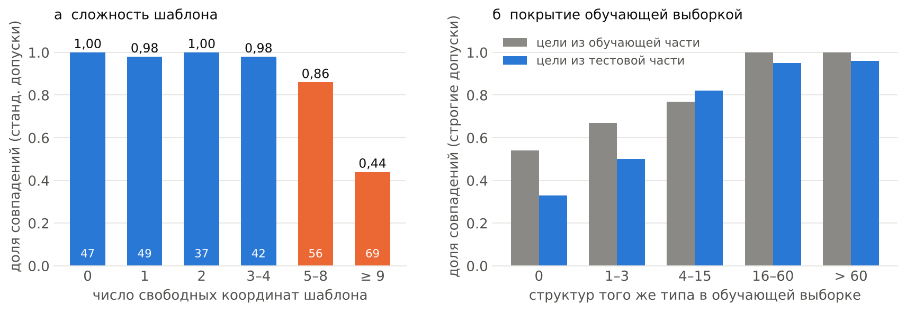
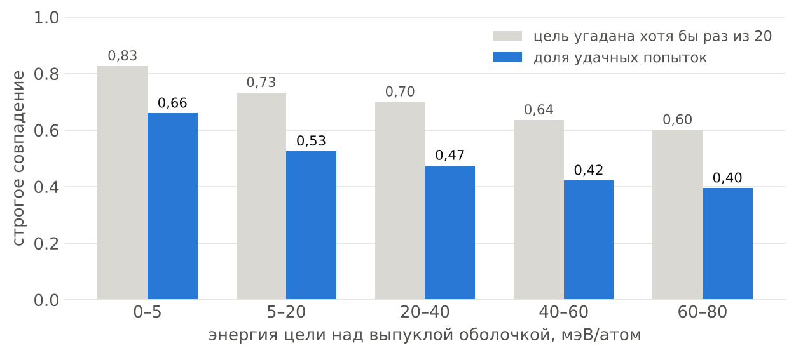
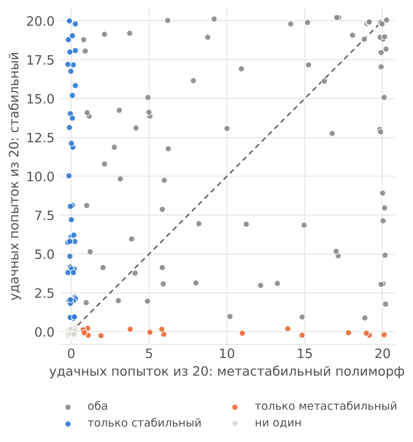
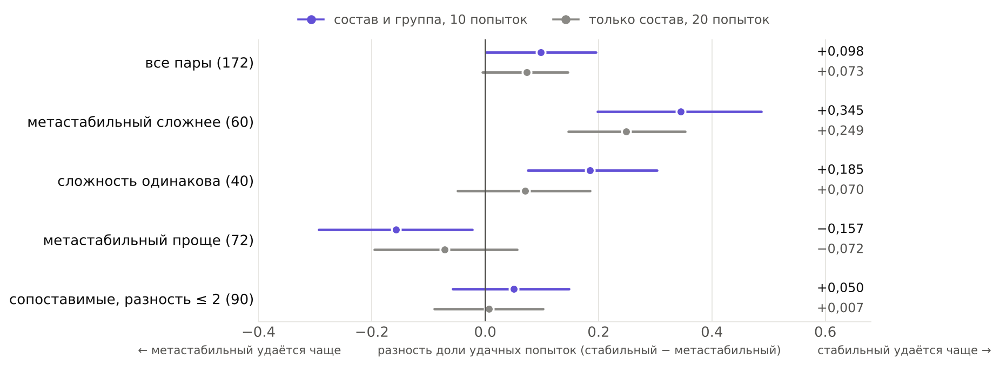
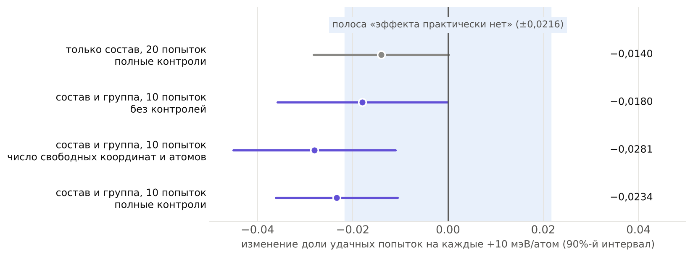
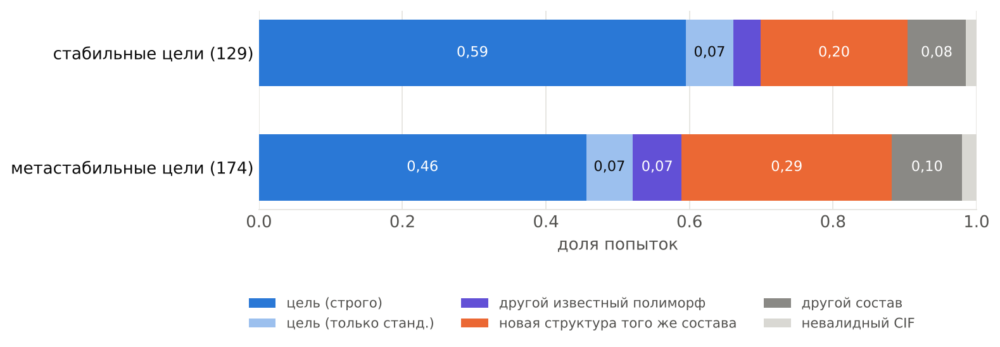
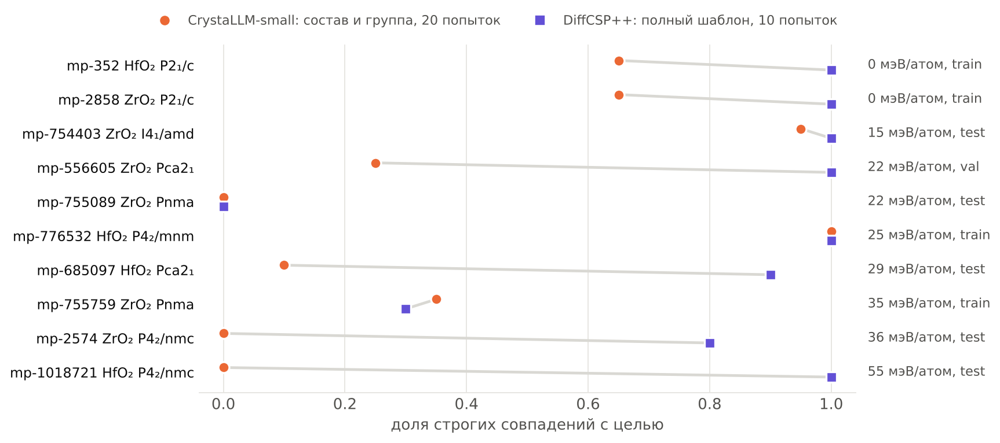
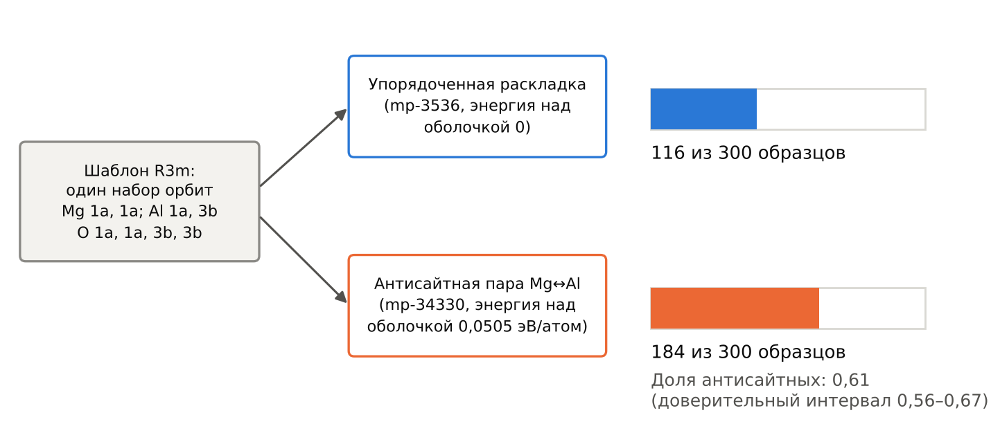

## Гипотеза 1. Зависимость точности условной генерации кристаллов от метастабильности целевой фазы

### Фазы HfO₂

**Первичный прогон.** $N=50$ образцов на каждую из двух фаз ($g_{\text{стаб}}=\text{P2}_1/c$, mp-352; $g_{\text{мета}}=\text{Pca2}_1$, mp-685097), DiffCSP++ (чекпоинт `mp_csp`), допуск симметрии $0{,}1$ Å. Доли совпадения по группе: $50/50$ и $40/50$, точный критерий Фишера $p=0{,}000593$. Отклонение CHGNet-энергии от эталона: $0{,}0031\pm0{,}0021$ эВ/атом ($N=50$) и $0{,}0483\pm0{,}0298$ эВ/атом ($N=40$), критерий Манна–Уитни $p<0{,}00001$; эталонные энергии CHGNet: $-10{,}6041$ и $-10{,}5860$ эВ/атом.

**Допуск симметрии.** Доля метастабильных образцов с группой SG29 при разных допусках (стабильные образцы имеют SG14 в $50/50$ при всех допусках):

| допуск, Å | образцов с SG29 | остальные группы |
|---|---|---|
| от 0,0001 до 0,01 | 50/50 | нет |
| 0,03 | 49/50 | SG60: 1 |
| 0,05 | 47/50 | SG61: 2, SG60: 1 |
| 0,1 | 40/50 | SG60: 7, SG61: 3 |
| 0,2 | 38/50 | SG60: 7, SG205: 5 |
| 0,3 | 37/50 | SG60: 7, SG205: 6 |

SG60 и SG61 центросимметричны; цепочка $29 \to 61 \to 205$ у трёх образцов (файлы 3, 9, 48) согласуется с отношением группа–подгруппа (проверка по Bilbao не выполнена).

**Окно допуска.** Оба эталона сохраняют целевую группу до $0{,}5$ Å (граница сетки), как и все $50$ стабильных образцов. У метастабильных образцов $36/50$ сохраняют группу до $0{,}5$ Å, $14/50$ теряют её при допуске от $0{,}029$ до $0{,}5$ Å (медиана $0{,}098$ Å).

**Принадлежность к обучающей выборке.** mp-352 входит в обучающую часть MP-20, mp-685097 — в тестовую. Структур группы SG14 в обучающей части $575$, группы SG29 — $10$ (SG60: $18$, SG61: $7$). Energy above hull mp-685097 в MP-20 равен $0{,}0286$ эВ/атом.

**Допуски `StructureMatcher`.** Строгие допуски $(0{,}2;\ 0{,}3;\ 5^\circ)$: стабильные образцы совпадают с mp-352 в $50/50$ (нормированное RMS $0{,}0075$), метастабильные с mp-685097 в $43/50$ (RMS $0{,}1031$), перекрёстных совпадений нет. Стандартные допуски $(0{,}3;\ 0{,}5;\ 10^\circ)$: метастабильные образцы совпадают с обоими эталонами в $50/50$, стабильные с mp-352 в $50/50$ и с mp-685097 в $43/50$.

**Релаксация CHGNet.** Эталоны: mp-352 $-10{,}6104$ эВ/атом (SG14 до и после), mp-685097 $-10{,}5923$ эВ/атом (SG29 до и после); зазор $0{,}0181$ эВ/атом (MP-20: $0{,}0286$). Стабильные образцы ($N=10$): энергия совпадает с эталоном в пределах $0{,}0002$ эВ/атом, SG14 в $10/10$. Метастабильные ($N=20$): до релаксации SG29 при допуске $0{,}1$ Å у $16/20$ (SG61: 2, SG60: 2), после релаксации у $18/20$ (SG60: 2); энергия над релаксированным эталоном стабильной фазы от $0{,}0033$ до $0{,}0183$ эВ/атом, среднее $0{,}0164$.

### Бенчмарк на тестовой части MP-20

**Дизайн.** $N=300$ целей из тестовой части MP-20 (структуры вне обучающей выборки), по $60$ в каждой из пяти корзин энергии над выпуклой оболочкой, одна генерация на цель, условие — группа, орбиты Вайкоффа и виды атомов из эталона, DiffCSP++ (`mp_csp`). Исходы: совпадение по `StructureMatcher` (стандартные и строгие допуски), сохранение группы при допуске $0{,}1$ Å, окно допуска. Контроли: число свободных параметров шаблона $n^{\text{своб}}$, число атомов, частота группы и частота прототипа в обучающей выборке. Корреляция энергии над выпуклой оболочкой с $n^{\text{своб}}$ равна $0{,}19$, с числом атомов $0{,}09$, с частотой группы $-0{,}13$; $n^{\text{своб}}$ и число орбит связаны коэффициентом $0{,}91$ (в модель входит $n^{\text{своб}}$). Медиана частоты прототипа по корзинам: $55$, $36$, $21{,}5$, $30$, $15{,}5$; для $17$ из $300$ целей прототип в обучающей выборке отсутствует.

**Доли успеха по корзинам энергии над выпуклой оболочкой:**

| корзина, эВ/атом | совпадение, стандартные допуски | совпадение, строгие допуски | сохранение группы при 0,1 Å |
|---|---|---|---|
| 0–0,005 | 0,87 | 0,82 | 1,00 |
| 0,005–0,02 | 0,83 | 0,78 | 0,97 |
| 0,02–0,04 | 0,88 | 0,78 | 0,98 |
| 0,04–0,06 | 0,87 | 0,78 | 0,98 |
| 0,06–0,08 | 0,73 | 0,68 | 0,97 |

**Сложность шаблона.** Доля совпадений (стандартные допуски) по числу свободных параметров:

| $n^{\text{своб}}$ | целей | доля совпадений |
|---|---|---|
| 0 | 47 | 1,00 |
| 1 | 49 | 0,98 |
| 2 | 37 | 1,00 |
| 3–4 | 42 | 0,98 |
| 5–8 | 56 | 0,86 |
| 9 и более | 69 | 0,44 |

**Модель логистической регрессии.** Отношение шансов (ОШ) совпадения на каждые $+10$ мэВ/атом энергии над выпуклой оболочкой:

| модель | ОШ | 95% ДИ | $p$ |
|---|---|---|---|
| стандартные допуски, без контролей | 0,904 | [0,803; 1,017] | 0,092 |
| стандартные допуски, с контролями | 1,057 | [0,899; 1,242] | 0,503 |
| строгие допуски, без контролей | 0,922 | [0,832; 1,023] | 0,125 |
| строгие допуски, с контролями | 1,060 | [0,915; 1,227] | 0,440 |
| стандартные допуски, $n^{\text{своб}} \geq 3$, с контролями | 1,077 | [0,912; 1,272] | 0,38 |
| строгие допуски, $n^{\text{своб}} \geq 3$, с контролями | 1,102 | [0,942; 1,288] | 0,225 |

Контрольные переменные в модели со стандартными допусками (ОШ на $+1$ стандартное отклонение): частота прототипа $3{,}86$ [$2{,}01$; $7{,}42$], $n^{\text{своб}}$ $0{,}20$ [$0{,}11$; $0{,}37$], частота группы $0{,}64$ [$0{,}39$; $1{,}06$], число атомов $1{,}45$ [$0{,}83$; $2{,}52$]. Для строгих допусков частота прототипа $3{,}74$, $n^{\text{своб}}$ $0{,}125$.

**RMSE среди совпавших.** Совпало $251$ цель, у $44$ из них RMSE равен нулю (структура задана шаблоном целиком). Среди $207$ остальных корреляция Спирмена RMSE с энергией над выпуклой оболочкой $\rho=0{,}087$ ($p=0{,}213$). В линейной модели для $\ln\text{RMSE}$ коэффициент при энергии над выпуклой оболочкой (на $+10$ мэВ/атом) $-0{,}015$ [$-0{,}109$; $0{,}079$], при $n^{\text{своб}}$ $+0{,}570$ [$0{,}300$; $0{,}840$], при $\ln(1+n^{\text{прот}})$ $-0{,}643$ [$-0{,}928$; $-0{,}358$].

**Окно допуска и полярные цели.** Окно определено у $241$ цели с $n^{\text{своб}}\geq1$ (у $12$ из $300$ эталонов целевой группы нет даже при допуске $0{,}001$ Å); хрупких эталонов с окном меньше $0{,}2$ Å среди них $3$. Доля недо-искажённых образцов по корзинам: $0{,}04$; $0{,}07$; $0{,}00$; $0{,}02$; $0{,}06$; медиана $\log_{10}(\tau_{\text{образец}}/\tau_{\text{эт}})$ равна нулю во всех корзинах, корреляция Спирмена с энергией над выпуклой оболочкой $\rho=0{,}012$ ($p=0{,}851$), ОШ недо-искажения на $+10$ мэВ/атом $0{,}904$ [$0{,}681$; $1{,}200$]. Полярных целей $58$ из $300$ ($57$ из $241$ с окнами). Недо-искажено $6/57$ полярных и $3/184$ неполярных образцов (точный критерий Фишера $p=0{,}0064$); у $4$ из $6$ полярных недо-искажённых образцов нет совпадения по стандартным допускам. Доля совпадений у полярных $0{,}53$, у неполярных $0{,}91$, медианы $n^{\text{своб}}$ $14{,}5$ и $2$, медианы частоты прототипа $5$ и $46{,}5$. ОШ полярности с контролями: $0{,}97$ [$0{,}29$; $3{,}25$] (стандартные допуски), $1{,}01$ [$0{,}32$; $3{,}15$] (строгие); среди полярных ($N=58$) ОШ энергии над выпуклой оболочкой $1{,}07$ [$0{,}84$; $1{,}37$], $p=0{,}58$.

**Окна эталонов по всей тестовой части.** Окно определено для $8732$ из $9046$ структур; $8450$ из них сохраняют группу до $0{,}49$ Å и выше. Число эталонов с окном меньше $0{,}05$, $0{,}1$, $0{,}2$, $0{,}3$ Å: $7$, $18$, $164$, $242$, из них полярных $0$, $5$, $81$, $113$. Среди этих структур полярных $1294$. Хрупкие эталоны (окно меньше $0{,}3$ Å) по корзинам энергии над выпуклой оболочкой: $87$, $38$, $55$, $29$, $33$.

**Контроль «train против test».** Набор из $300$ целей обучающей части MP-20 ($60$ в каждой из тех же корзин энергии над выпуклой оболочкой), одна генерация на цель, те же условие и метрики; частоты группы и прототипа для этих целей считаются без учёта самой цели. В наборе $45$ целей с $n^{\text{своб}}=0$ и $13$ целей, у которых нет других структур того же прототипа. Доля совпадений (строгие допуски) по корзинам энергии над выпуклой оболочкой:

| корзина, эВ/атом | тестовая часть | обучающая часть |
|---|---|---|
| 0–0,005 | 0,82 | 0,92 |
| 0,005–0,02 | 0,78 | 0,88 |
| 0,02–0,04 | 0,78 | 0,80 |
| 0,04–0,06 | 0,78 | 0,75 |
| 0,06–0,08 | 0,68 | 0,82 |

Логистическая регрессия на объединённых данных с теми же контролями и индикатором принадлежности к обучающей выборке $T$ (цели с $n^{\text{своб}}\geq1$: $253$ из тестовой части и $255$ из обучающей), ОШ при $T=1$ (односторонний критерий $H_1$: ОШ $>1$):

| исход и отбор | ОШ | 95% ДИ | $p$ |
|---|---|---|---|
| строгие допуски, $n^{\text{своб}}\geq1$ | 2,52 | [1,40; 4,54] | 0,0011 |
| строгие допуски, $n^{\text{своб}}\geq3$ | 2,37 | [1,31; 4,30] | 0,0022 |
| стандартные допуски, $n^{\text{своб}}\geq1$ | 2,09 | [1,11; 3,91] | 0,011 |
| стандартные допуски, $n^{\text{своб}}\geq3$ | 2,03 | [1,08; 3,81] | 0,014 |

ОШ энергии над выпуклой оболочкой на $+10$ мэВ/атом (строгие допуски, $n^{\text{своб}}\geq1$): только тестовая часть $1{,}07$ [$0{,}92$; $1{,}24$], только обучающая часть $1{,}08$ [$0{,}89$; $1{,}31$]; коэффициент взаимодействия энергия $\times$ $T$ даёт ОШ $1{,}01$ [$0{,}80$; $1{,}27$] ($p=0{,}953$). Объединение двух оценок по обратным дисперсиям даёт ОШ $1{,}07$ [$0{,}95$; $1{,}20$] на $+10$ мэВ/атом, то есть на всём диапазоне $0$–$0{,}08$ эВ/атом нижняя граница интервала равна $0{,}953^8\approx0{,}68$.

**Ближайшие структуры в обучающей выборке.** Для каждой из $600$ целей ($300$ из тестовой и $300$ из обучающей части) в обучающей выборке взяты структуры того же прототипа (анонимизированная формула и группа; для цели из обучающей части сама цель исключена), не более $400$ случайных кандидатов на прототип; для $14{,}3\%$ целей тестовой и $15{,}3\%$ целей обучающей части кандидатов было больше, число соседей для них занижено. Сравнение через `StructureMatcher` со строгими допусками: число структур того же структурного типа $n^{\text{тип}}$ (допускается замена элементов) и число структур той же химии (почти дубликатов). Доля целей хотя бы с одним соседом того же типа: $0{,}85$ в тестовой и $0{,}87$ в обучающей части, медиана $n^{\text{тип}}$ равна $15$ и $12{,}5$; почти дубликат той же химии найден у одной цели из $300$ тестовой части и у $0$ из $300$ обучающей (отдельный фактор в модель не входит). В модель добавлен $\ln(1+n^{\text{тип}})$; ОШ на $+1$ стандартное отклонение, цели с $n^{\text{своб}}\geq1$:

| исход и отбор | ОШ числа структур того же типа | 95% ДИ | ОШ принадлежности к обучающей части | 95% ДИ | $p$ (односторонний) |
|---|---|---|---|---|---|
| строгие допуски, $n^{\text{своб}}\geq1$ | 6,85 | [3,68; 12,78] | 2,66 | [1,43; 4,98] | 0,0011 |
| строгие допуски, $n^{\text{своб}}\geq3$ | 4,95 | [2,75; 8,90] | 2,70 | [1,42; 5,12] | 0,0012 |
| стандартные допуски, $n^{\text{своб}}\geq1$ | 5,40 | [2,83; 10,28] | 2,10 | [1,09; 4,04] | 0,013 |
| стандартные допуски, $n^{\text{своб}}\geq3$ | 3,45 | [1,98; 6,03] | 2,09 | [1,09; 4,03] | 0,013 |

Только по тестовой части ОШ числа структур того же типа равен $9{,}09$ [$3{,}99$; $20{,}74$] (строгие допуски, $n^{\text{своб}}\geq1$). ОШ энергии над выпуклой оболочкой на $+10$ мэВ/атом при учёте соседей: $1{,}05$ [$0{,}92$; $1{,}18$] по всем целям и $1{,}02$ [$0{,}87$; $1{,}20$] только по тестовой части.

**Покрытие обучающей выборкой.** Доля совпадений (строгие допуски, цели с $n^{\text{своб}}\geq1$) по числу структур того же типа в обучающей выборке, в скобках число целей:

| число структур того же типа | тестовая часть | обучающая часть |
|---|---|---|
| 0 | 0,33 (46) | 0,54 (37) |
| 1–3 | 0,50 (44) | 0,67 (52) |
| 4–15 | 0,82 (62) | 0,77 (69) |
| 16–60 | 0,95 (55) | 1,00 (44) |
| более 60 | 0,96 (46) | 1,00 (53) |
| все цели | 0,73 (253) | 0,80 (255) |

Для стандартных допусков доли выше: $0{,}46$; $0{,}64$; $0{,}90$; $0{,}98$; $0{,}98$ (тестовая часть) и $0{,}65$; $0{,}69$; $0{,}88$; $1{,}00$; $1{,}00$ (обучающая часть).

*Рис. 1. DiffCSP++ с полным шаблоном, одна попытка на цель. (а) Доля совпадений по числу свободных координат шаблона, внизу столбцов — число целей. (б) Доля совпадений по числу структур того же типа в обучающей выборке, цели с $n^{\text{своб}}\geq1$.*

### Вторая модель: CrystaLLM-small

**Модель и данные.** CrystaLLM-small (25,36 млн параметров, чекпоинт `cif_model_mp_20_b`, обучена на обучающей части MP-20), условие мягкое: состав в ячейке и, необязательно, символ группы в запросе. Три набора: (а) готовые генерации авторов на всей тестовой части MP-20 (9046 целей, $K=20$, запрос — только состав, $180920$ генераций); (б) собственные генерации на $300$ целях бенчмарка с группой в запросе ($K=1$); (в) собственные генерации на парном наборе (см. ниже). Исходы те же: совпадение по `StructureMatcher` (строгие и стандартные допуски), совпадение состава, сохранение группы при допуске $0{,}1$ Å. Скорость генерации на CPU около $23$ с на структуру для целей бенчмарка.

**Полная тестовая часть, запрос только с составом.** Валидных CIF $0{,}980$, состав совпал в $0{,}887$ попыток. Доли по корзинам энергии над выпуклой оболочкой (все попытки):

| корзина, эВ/атом | целей | валидных | состав совпал | совпадение, стандартные | совпадение, строгие | группа верна (0,1 Å) |
|---|---|---|---|---|---|---|
| 0–0,005 | 4759 | 0,984 | 0,915 | 0,704 | 0,660 | 0,748 |
| 0,005–0,02 | 1383 | 0,974 | 0,866 | 0,577 | 0,526 | 0,650 |
| 0,02–0,04 | 1231 | 0,976 | 0,862 | 0,532 | 0,475 | 0,596 |
| 0,04–0,06 | 906 | 0,973 | 0,846 | 0,483 | 0,422 | 0,578 |
| 0,06–0,08 | 767 | 0,979 | 0,842 | 0,455 | 0,395 | 0,586 |

Доля целей, угаданных хотя бы раз за $20$ попыток:

| корзина, эВ/атом | стандартные допуски | строгие допуски |
|---|---|---|
| 0–0,005 | 0,872 | 0,827 |
| 0,005–0,02 | 0,798 | 0,733 |
| 0,02–0,04 | 0,771 | 0,700 |
| 0,04–0,06 | 0,744 | 0,636 |
| 0,06–0,08 | 0,699 | 0,601 |

*Рис. 2. CrystaLLM-small на всей тестовой части MP-20, запрос только с составом, 20 попыток на цель, строгие допуски: доля удачных попыток и доля целей, угаданных хотя бы раз, по корзинам энергии над выпуклой оболочкой.*

**Ближайшие структуры для всей тестовой части.** Счётчик $n^{\text{тип}}$ посчитан для $9346$ целей ($9046$ тестовых и $300$ обучающих); кандидатов из обучающей выборки $21779$ (до ограничения $24403$). Доля целей хотя бы с одним соседом того же типа: $0{,}876$ в тестовой и $0{,}873$ в обучающей части, медиана $n^{\text{тип}}$ равна $22$ и $12{,}5$, медиана нормированного RMS до ближайшего $0{,}003$ и $0{,}005$; почти дубликат той же химии найден у $0{,}3\%$ тестовых целей; ограничение на число кандидатов сработало у $18{,}1\%$ тестовых и $15{,}3\%$ обучающих целей. Для прежних $600$ целей значения отличаются от таблицы выше: там по $60$ целей в каждой корзине, то есть метастабильные цели представлены сильнее, чем в полной тестовой части, а при превышении ограничения подвыборка кандидатов случайна.

**Модель между составами.** ОШ совпадения на $+10$ мэВ/атом, логистическая регрессия по попыткам с кластеризацией по цели, контроли $n^{\text{гр}}$, $n^{\text{ат}}$, $n^{\text{своб}}$, $n^{\text{прот}}$ (и $n^{\text{тип}}$ там, где указано). Цели с $n^{\text{своб}}\geq1$: $7281$ цель, $145620$ попыток. Граница эквивалентности $[0{,}917;\ 1{,}090]$, $p_{\text{экв}}$ — большее из двух односторонних $p$.

| исход и отбор | ОШ | 95% ДИ | $p_{\text{экв}}$ |
|---|---|---|---|
| строгие допуски, без $n^{\text{тип}}$ | 0,894 | [0,877; 0,911] | 0,9956 |
| строгие допуски, с $n^{\text{тип}}$ | 0,890 | [0,873; 0,908] | 0,9987 |
| строгие допуски, с $n^{\text{тип}}$, без целей с ограничением | 0,894 | [0,876; 0,913] | 0,9922 |
| стандартные допуски, без $n^{\text{тип}}$ | 0,904 | [0,888; 0,921] | 0,9359 |
| стандартные допуски, с $n^{\text{тип}}$ | 0,903 | [0,887; 0,920] | 0,9458 |
| группа верна (0,1 Å), без $n^{\text{тип}}$ | 0,935 | [0,919; 0,952] | 0,0159 |
| строгие допуски, $n^{\text{своб}}\geq3$ ($4665$ целей), без $n^{\text{тип}}$ | 0,896 | [0,875; 0,917] | 0,9754 |
| стандартные допуски, $n^{\text{своб}}\geq3$, без $n^{\text{тип}}$ | 0,908 | [0,889; 0,928] | 0,8112 |
| строгие допуски, только попытки с верным составом | 0,894 | [0,876; 0,911] | 0,9953 |
| стандартные допуски, только попытки с верным составом | 0,902 | [0,885; 0,919] | 0,9575 |

Для $n^{\text{своб}}\geq3$ и исхода «группа верна» ОШ $0{,}950$ [$0{,}930$; $0{,}970$], $p_{\text{экв}}=0{,}0004$.

**Ступень и наклон (разведочный анализ).** Индикатор $S=\mathbb{1}[E\geq0{,}005]$ эВ/атом; модели с $n^{\text{тип}}$, цели с $n^{\text{своб}}\geq1$, ОШ:

| исход | модель | ОШ | 95% ДИ | $p_{\text{экв}}$ |
|---|---|---|---|---|
| строгие | только ступень $S$ | 0,590 | [0,541; 0,643] | 1,0000 |
| строгие | наклон на $+10$ мэВ среди $E\geq0{,}005$ | 0,939 | [0,912; 0,966] | 0,0533 |
| строгие | ступень $S$ при учёте наклона | 0,744 | [0,651; 0,850] | 0,9990 |
| строгие | наклон при учёте ступени | 0,935 | [0,908; 0,964] | 0,0952 |
| стандартные | только ступень $S$ | 0,618 | [0,569; 0,672] | 1,0000 |
| стандартные | наклон на $+10$ мэВ среди $E\geq0{,}005$ | 0,950 | [0,925; 0,976] | 0,0049 |
| стандартные | ступень $S$ при учёте наклона | 0,747 | [0,657; 0,851] | 0,9990 |
| стандартные | наклон при учёте ступени | 0,947 | [0,921; 0,974] | 0,0109 |

**Запрос с группой на $300$ целях бенчмарка ($K=1$).** Валидных CIF $0{,}95$, состав совпал в $0{,}87$ случаев:

| корзина, эВ/атом | валидных | состав совпал | совпадение, стандартные | совпадение, строгие | группа верна (0,01 Å) | группа верна (0,1 Å) |
|---|---|---|---|---|---|---|
| 0–0,005 | 0,97 | 0,95 | 0,80 | 0,77 | 0,97 | 0,97 |
| 0,005–0,02 | 0,95 | 0,88 | 0,67 | 0,57 | 0,95 | 0,95 |
| 0,02–0,04 | 0,92 | 0,82 | 0,63 | 0,50 | 0,90 | 0,90 |
| 0,04–0,06 | 1,00 | 0,95 | 0,68 | 0,55 | 0,98 | 0,98 |
| 0,06–0,08 | 0,93 | 0,75 | 0,50 | 0,45 | 0,92 | 0,90 |

ОШ на $+10$ мэВ/атом с теми же контролями, что для бенчмарка DiffCSP++ (без $n^{\text{тип}}$): строгие допуски $0{,}944$ [$0{,}838$; $1{,}064$], $p=0{,}349$ ($N=253$ цели с $n^{\text{своб}}\geq1$); $n^{\text{своб}}\geq3$ ($N=167$) $0{,}954$ [$0{,}821$; $1{,}108$]; стандартные допуски $0{,}949$ [$0{,}835$; $1{,}078$] ($N=253$) и $0{,}959$ [$0{,}823$; $1{,}117$] ($N=167$).

**Режим запроса на одних и тех же $300$ целях.** Те же цели в готовых генерациях без группы ($K=20$, $6000$ попыток). Доли по корзинам:

| корзина, эВ/атом | совпадение, строгие: с группой | совпадение, строгие: без группы | совпадение, стандартные: с группой | совпадение, стандартные: без группы | группа верна (0,1 Å): с группой | группа верна (0,1 Å): без группы |
|---|---|---|---|---|---|---|
| 0–0,005 | 0,77 | 0,68 | 0,80 | 0,76 | 0,97 | 0,78 |
| 0,005–0,02 | 0,57 | 0,56 | 0,67 | 0,62 | 0,95 | 0,67 |
| 0,02–0,04 | 0,50 | 0,47 | 0,63 | 0,53 | 0,90 | 0,60 |
| 0,04–0,06 | 0,55 | 0,41 | 0,68 | 0,48 | 0,98 | 0,61 |
| 0,06–0,08 | 0,45 | 0,39 | 0,50 | 0,45 | 0,90 | 0,58 |

Средняя разность доли успеха по целям (строгие допуски, с группой минус без группы) $+0{,}066$ (95% ДИ $\pm0{,}037$); по корзинам $+0{,}087$; $+0{,}011$; $+0{,}029$; $+0{,}144$; $+0{,}059$ ($60$ целей в корзине). ОШ на $+10$ мэВ/атом без ковариат: $0{,}877$ [$0{,}802$; $0{,}959$] с группой и $0{,}861$ [$0{,}798$; $0{,}928$] без группы. При верном составе доля совпадений (строгие допуски) по корзинам: $0{,}81$; $0{,}64$; $0{,}61$; $0{,}58$; $0{,}60$ с группой ($261$ попытка) и $0{,}74$; $0{,}61$; $0{,}53$; $0{,}47$; $0{,}49$ без группы ($5243$ попытки).

Совместная модель с $n^{\text{тип}}$ и взаимодействием энергия $\times$ режим, цели с $n^{\text{своб}}\geq1$ ($253$ цели):

| исход | параметр | ОШ | 95% ДИ | $p$ |
|---|---|---|---|---|
| строгие | наклон с группой, на $+10$ мэВ | 0,898 | [0,787; 1,025] | 0,111 |
| строгие | наклон без группы, на $+10$ мэВ | 0,863 | [0,789; 0,943] | 0,0012 |
| строгие | группа в запросе при $E=0$ | 1,327 | [0,840; 2,096] | 0,226 |
| строгие | разность наклонов (с группой минус без группы) | 1,040 | [0,930; 1,162] | 0,496 |
| стандартные | наклон с группой, на $+10$ мэВ | 0,912 | [0,794; 1,049] | 0,197 |
| стандартные | наклон без группы, на $+10$ мэВ | 0,851 | [0,780; 0,928] | 0,0003 |
| стандартные | группа в запросе при $E=0$ | 1,539 | [0,927; 2,556] | 0,096 |
| стандартные | разность наклонов (с группой минус без группы) | 1,055 | [0,936; 1,189] | 0,380 |

**Внутри состава, запрос только с составом ($K=20$).** Составов с не менее чем двумя структурами $377$, целей $889$, медианный разброс энергии над выпуклой оболочкой внутри состава $16{,}3$ мэВ/атом. Внутригрупповая линейная модель с фиксированными эффектами состава; изменение доли успеха на $+10$ мэВ/атом (доли единицы), 95% ДИ, кластеры — составы; контроли — $n^{\text{гр}}$, $n^{\text{ат}}$, $n^{\text{своб}}$, $n^{\text{прот}}$, $n^{\text{тип}}$:

| исход | без контролей | $p$ | с контролями | $p$ |
|---|---|---|---|---|
| совпадение, строгие | −0,0095 [−0,0239; +0,0049] | 0,197 | −0,0044 [−0,0175; +0,0086] | 0,503 |
| совпадение, стандартные | −0,0027 [−0,0174; +0,0121] | 0,723 | +0,0014 [−0,0121; +0,0148] | 0,842 |
| группа верна (0,1 Å) | −0,0006 [−0,0164; +0,0152] | 0,937 | +0,0053 [−0,0088; +0,0195] | 0,460 |
| состав совпал | +0,0012 [−0,0032; +0,0055] | 0,601 | +0,0014 [−0,0030; +0,0058] | 0,531 |

При контролях 95% ДИ для всех четырёх исходов лежит внутри $\pm\delta_p=\pm0{,}0216$ (запрос только с составом); без контролей для строгих допусков нижняя граница $-0{,}0239$ выходит за $-\delta_p$. Основной критерий — режим с группой в запросе — разобран в разделе «Пары полиморфов при группе в запросе».

Парное сравнение (почти стабильный, $E<0{,}005$, против метастабильного, $E\geq0{,}005$ эВ/атом полиморфа одного состава): составов с обоими типами $133$, средняя разность энергий над выпуклой оболочкой $31{,}4$ мэВ/атом. Средняя разность доли успеха (стабильный минус метастабильный), 95% ДИ бутстрэпом по составам:

| исход | разность | 95% ДИ | составов с $\Delta_c\neq0$ | стабильный лучше | знаковый критерий $p$ |
|---|---|---|---|---|---|
| совпадение, строгие | +0,035 | [−0,041; +0,110] | 105 | 57 | 0,435 |
| совпадение, стандартные | +0,006 | [−0,066; +0,083] | 118 | 59 | 1,000 |
| группа верна (0,1 Å) | +0,014 | [−0,067; +0,094] | 117 | 55 | 0,579 |

Для сравнения, между составами разность доли совпадений (строгие допуски) между корзиной $E<0{,}005$ ($0{,}660$) и остальными корзинами (среднее по остальным корзинам, взвешенное по числу попыток, $0{,}466$; рассчитано по таблице выше) равна $0{,}194$.

**Парный набор с группой в запросе.** Собран набор из всех $889$ тестовых структур $377$ составов, у которых есть другая структура того же состава; по корзинам энергии над выпуклой оболочкой: $221$; $167$; $206$; $155$; $140$; $n^{\text{своб}}=0$ у $117$ структур. Запрос — состав и символ группы каждой структуры, $K=3$, порядок обработки случаен, всего $18$ частей по $50$ целей (последняя неполная). Готовы все $18$ частей; на целях набора `pairs_v1` результат разобран ниже (раздел «Пары полиморфов при группе в запросе»), по остальным целям набора разбор не проводился.

### Отдельные материалы: пары полиморфов одного состава (CrystaLLM-small, запрос только с составом, $K=20$)

**Набор пар.** Составы тестовой части, у которых есть и почти стабильный ($E<0{,}005$ эВ/атом), и метастабильный полиморф; в паре берётся самый низкий по энергии почти стабильный полиморф и один из метастабильных. Исключены $8$ записей, группа которых не воспроизводится при допуске $0{,}1$ Å. Итого $129$ составов, $172$ пары, $303$ структуры ($n^{\text{своб}}\geq1$ у $251$); медианная разность энергий в паре $27{,}1$ мэВ/атом. Для каждой структуры посчитано число удачных попыток из $20$ (строгие допуски). Ни разу не воспроизведены $29\%$ почти стабильных и $45\%$ метастабильных полиморфов.

| пары | пар | составов | доля удачных попыток: стабильный | доля удачных попыток: метастабильный | разность | 95% ДИ | хотя бы одна удача: разность | 95% ДИ |
|---|---|---|---|---|---|---|---|---|
| все | 172 | 129 | 0,375 | 0,302 | +0,073 | [−0,005; +0,146] | +0,157 | [+0,042; +0,268] |
| оба $n^{\text{своб}}\geq1$ | 129 | 94 | 0,300 | 0,233 | +0,067 | [−0,014; +0,144] | +0,163 | [+0,018; +0,305] |
| одинаковое число атомов (одинаковый запрос) | 85 | 65 | 0,352 | 0,282 | +0,070 | [−0,012; +0,147] | +0,212 | [+0,088; +0,330] |

ДИ — бутстрэп по составам ($B=3000$). Категории пар (хотя бы одна удача из $20$): оба полиморфа — $76$, только стабильный — $44$, только метастабильный — $17$, ни один — $35$; среди пар с одинаковым запросом $40$, $19$, $1$ и $25$. По составам стабильный полиморф лучше в $56$ из $101$ составов с различием (знаковый критерий $p=0{,}320$), среди пар с одинаковым запросом — в $30$ из $45$ ($p=0{,}036$).

*Рис. 3. Каждая пара полиморфов — одна точка: число удачных попыток метастабильного (по горизонтали) и стабильного (по вертикали) полиморфа из 20, запрос только с составом. Точки выше диагонали — пары, где стабильный воспроизводится чаще.*

**Сложность шаблона в парах.** У метастабильного полиморфа больше свободных координат в $60$ парах, меньше — в $72$, столько же — в $40$ (среднее $\Delta n^{\text{своб}}=-0{,}35$). Разность долей удачных попыток по стратам (разведочно, страты выделены по наблюдаемым данным):

| страта | пар | составов | разность | 95% ДИ | хотя бы одна удача: разность | 95% ДИ |
|---|---|---|---|---|---|---|
| метастабильный сложнее ($\Delta n^{\text{своб}}>0$) | 60 | 46 | +0,249 | [+0,147; +0,353] | +0,350 | [+0,160; +0,525] |
| сложность одинакова ($\Delta n^{\text{своб}}=0$) | 40 | 35 | +0,070 | [−0,049; +0,185] | — | — |
| метастабильный проще ($\Delta n^{\text{своб}}<0$) | 72 | 60 | −0,072 | [−0,196; +0,056] | — | — |
| сопоставимые ($\lvert\Delta n^{\text{своб}}\rvert\leq2$) | 90 | 78 | +0,007 | [−0,090; +0,102] | +0,000 | [−0,110; +0,111] |

**Модель внутри состава на наборе пар.** Изменение доли удачных попыток на $+10$ мэВ/атом с контролями $n^{\text{гр}}$, $n^{\text{ат}}$, $n^{\text{своб}}$, $n^{\text{прот}}$, $n^{\text{тип}}$: $-0{,}0140$ [$-0{,}0309$; $+0{,}0029$], 90% ДИ [$-0{,}0282$; $+0{,}0002$]; с контролями только $n^{\text{своб}}$ и $n^{\text{ат}}$: $-0{,}0187$ [$-0{,}0376$; $+0{,}0002$]; стандартные допуски с полными контролями: $-0{,}0090$ [$-0{,}0270$; $+0{,}0091$]. На всех $377$ составах та же модель даёт $-0{,}0044$ [$-0{,}0175$; $+0{,}0086$], на $206$ составах без почти стабильного полиморфа $-0{,}0043$ [$-0{,}0225$; $+0{,}0140$]. Граница эквивалентности $\pm0{,}0216$: на всех составах принимается, на наборе пар — нет.

**Примеры** (удачных попыток из $20$, строгие допуски):

| состав | стабильный, группа | $n^{\text{своб}}$ | удачи | метастабильный, группа | $n^{\text{своб}}$ | удачи | $\Delta E$, мэВ/атом |
|---|---|---|---|---|---|---|---|
| SiO₂ | mp-6945, P4₁2₁2 | 4 | 6 | mp-556662, C2 | 17 | 0 | 67 |
| NbFeO₄ | mp-31761, C2/m | 12 | 4 | mp-22194, P2/c | 8 | 0 | 63 |
| AlV₂O₄ | mp-1286807, Imma | 5 | 3 | mp-19456, Fd-3m | 1 | 20 | 53 |
| Mn₃Si | mp-20211, Fm-3m | 0 | 14 | mp-1221697, P4/mmm | 1 | 1 | 74 |
| CeMg₅ | mp-1038976, P-6m2 | 2 | 7 | mp-1039088, Cm | 12 | 15 | 70 |
| HfIr | mp-1007786, P2₁/m | 4 | 0 | mp-1018055, Pmma | 2 | 6 | 19 |

**HfO₂ при запросе только с составом.** Фаза Pca2₁ (mp-685097, тестовая часть) не получила строгого совпадения ни в одной из $20$ попыток; при стандартных допусках совпадений $14/20$; группа Pca2₁ при допуске $0{,}1$ Å — $0/20$. Фаза P4₂/nmc (mp-1018721) — $0/20$ строгих и $13/20$ стандартных совпадений. Стабильная фаза P2₁/c (mp-352) лежит в обучающей части и в этот набор не входит. Какие структуры выданы вместо Pca2₁, покажет перекрёстное сопоставление со всеми полиморфами HfO₂ в MP-20 (скрипт `analysis/cross_match.py`).

**Ограничения раздела.** Запрос без группы, поэтому раздел не отвечает на вопрос о явно заданной симметрии. Страты по сложности и показатель «хотя бы одна удача» выделены по наблюдаемым данным. Пары одного состава зависимы (учтено бутстрэпом по составам). Энергии выданных структур в этом разделе не считались (для режима с группой см. раздел «Что модель выдаёт вместо цели»).

**Итог.** HfO₂ (DiffCSP++, $N=50$ на фазу). Различие долей совпадения по группе между фазами P2₁/c и Pca2₁ наблюдается при допуске $0{,}1$ Å и исчезает при допуске не выше $0{,}01$ Å; фазы различаются принадлежностью к обучающей и тестовой частям, поэтому этот набор фаз не отделяет энергию от принадлежности к обучающей выборке.

DiffCSP++ ($300$ тестовых и $300$ обучающих целей, $K=1$). Связь энергии над выпуклой оболочкой с вероятностью воспроизведения при контроле сложности шаблона и частоты прототипа не обнаружена: ОШ на $+10$ мэВ/атом $1{,}057$ [$0{,}899$; $1{,}242$] (стандартные допуски, тестовые цели); интервал не исключает ни отсутствия эффекта, ни снижения шансов на $10\%$ на каждые $10$ мэВ/атом. Успех сильно связан с числом свободных параметров шаблона и с числом структур того же типа в обучающей выборке (ОШ $6{,}9$ на стандартное отклонение); для целей из обучающей выборки шансы выше (ОШ $2{,}52$ [$1{,}40$; $4{,}54$], при учёте структур того же типа $2{,}7$).

CrystaLLM-small, между составами (весь test, запрос — состав, $K=20$). ОШ на $+10$ мэВ/атом $0{,}890$ [$0{,}873$; $0{,}908$] (строгие допуски, с $n^{\text{тип}}$), эквивалентность границам $[0{,}917;\ 1{,}090]$ не принята; учёт покрытия оценку почти не меняет ($0{,}894$ без $n^{\text{тип}}$). По разведочной модели снижение сосредоточено на переходе от целей с $E<0{,}005$ эВ/атом к остальным (ОШ ступени $0{,}744$ при учёте наклона), наклон внутри метастабильного диапазона $0{,}935$–$0{,}950$ на $+10$ мэВ/атом.

CrystaLLM-small, внутри состава (запрос — состав, $K=20$). На всех $377$ составах линейная оценка $-0{,}0044$ [$-0{,}0175$; $+0{,}0086$] на $+10$ мэВ/атом лежит в границах $\pm0{,}0216$. На $129$ составах, где есть и почти стабильный, и метастабильный полиморф, оценка $-0{,}0140$ [$-0{,}0309$; $+0{,}0029$], эквивалентность не принята; средняя разность долей «стабильный минус метастабильный» $+0{,}073$ [$-0{,}005$; $+0{,}146$], доля пар, где стабильный воспроизведён хотя бы раз, выше на $0{,}157$ [$0{,}042$; $0{,}268$]. По разведочному разбиению различие приходится на пары, где у метастабильного полиморфа больше свободных координат ($+0{,}249$ [$+0{,}147$; $+0{,}353$], $60$ пар); в парах сопоставимой сложности оно $+0{,}007$ [$-0{,}090$; $+0{,}102$] ($90$ пар). Утверждать отсутствие смещения внутри состава эти данные не позволяют.

CrystaLLM-small, группа в запросе ($300$ целей, $K=1$). Доля совпадений выше в среднем на $0{,}066$ ($\pm0{,}037$), доля верной группы — $0{,}90$–$0{,}98$ против $0{,}58$–$0{,}78$; различие наклонов по энергии между режимами не обнаружено (отношение $1{,}040$ [$0{,}930$; $1{,}162$]), но интервал не исключает различия на $\pm10\%$. Режим с группой на парах полиморфов разобран в разделе «Пары полиморфов при группе в запросе»; DiffCSP++ на парах не оценивался.

Не выполнено по гипотезе 1: DiffCSP++ с полным шаблоном на парах полиморфов (набор `pairs_v1nf`, $251$ структура), расширение на новые составы, условная генерация на $1500$–$2000$ стратифицированных тестовых целях.

---

### Пары полиморфов при группе в запросе (CrystaLLM-small, $K=10$)

**Данные.** Те же $303$ структуры набора `pairs_v1` ($129$ составов, $172$ пары), запрос — состав и символ группы цели. Попыток на цель $10$: $3$ из парного прогона ($K=3$, `seed` 1337) и $7$ новых (`seed` 2024); среди $2121$ новой попытки нет ни одного CIF, совпадающего с прежними попытками той же цели. Исход — строгое совпадение `StructureMatcher`. Ни разу за $10$ попыток не воспроизведены $26\%$ почти стабильных и $35\%$ метастабильных полиморфов (без группы при $K=20$: $29\%$ и $45\%$).

| пары | пар | составов | доля удачных попыток: стабильный | доля удачных попыток: метастабильный | разность | 95% ДИ | хотя бы одна удача: разность | 95% ДИ |
|---|---|---|---|---|---|---|---|---|
| все | 172 | 129 | 0,569 | 0,472 | +0,098 | [+0,002; +0,195] | +0,070 | [−0,048; +0,187] |
| оба $n^{\text{своб}}\geq1$ | 129 | 94 | 0,467 | 0,386 | +0,081 | [−0,024; +0,192] | +0,078 | [−0,069; +0,220] |
| одинаковое число атомов | 85 | 65 | 0,555 | 0,419 | +0,136 | [+0,031; +0,253] | +0,118 | [−0,011; +0,250] |

ДИ — бутстрэп по составам ($B=3000$). Категории пар (хотя бы одна удача из $10$): оба полиморфа / только стабильный / только метастабильный / ни один — $90$ / $33$ / $21$ / $28$ для всех пар, $55$ / $28$ / $18$ / $28$ при $n^{\text{своб}}\geq1$, $45$ / $14$ / $4$ / $22$ при одинаковом числе атомов. Стабильный полиморф лучше в $52$ из $90$ составов с различием (знаковый критерий $p=0{,}170$), при $n^{\text{своб}}\geq1$ — в $36$ из $66$ ($p=0{,}539$), при одинаковом числе атомов — в $26$ из $39$ ($p=0{,}053$).

**Страты по сложности шаблона** (разведочно: страты выделены по данным без группы; цели те же, поэтому это не независимая проверка):

| страта | пар | составов | $K=10$, группа в запросе | $K=3$, группа в запросе | $K=20$, только состав |
|---|---|---|---|---|---|
| метастабильный сложнее ($\Delta n^{\text{своб}}>0$) | 60 | 46 | +0,345 [+0,198; +0,487] | +0,344 [+0,189; +0,490] | +0,249 [+0,147; +0,353] |
| сложность одинакова ($\Delta n^{\text{своб}}=0$) | 40 | 35 | +0,185 [+0,075; +0,303] | +0,192 [+0,070; +0,325] | +0,070 [−0,049; +0,185] |
| метастабильный проще ($\Delta n^{\text{своб}}<0$) | 72 | 60 | −0,157 [−0,294; −0,023] | −0,125 [−0,269; +0,017] | −0,072 [−0,196; +0,056] |
| сопоставимые ($\left|\Delta n^{\text{своб}}\right|\leq2$) | 90 | 78 | +0,050 [−0,057; +0,148] | +0,078 [−0,040; +0,186] | +0,007 [−0,090; +0,102] |

Знак разности повторяет знак $\Delta n^{\text{своб}}$: чем сложнее шаблон метастабильного полиморфа, тем реже он воспроизводится, а при более простом шаблоне метастабильный полиморф воспроизводится чаще стабильного. В страте одинаковой сложности разность положительна, и её ДИ не содержит нуля. В страте $\left|\Delta n^{\text{своб}}\right|\leq2$ общий ДИ нуль содержит; по арифметике средних на пары с $\Delta n^{\text{своб}}\neq0$ внутри этой страты приходится разность около $-0{,}06$.

*Рис. 4. Разность долей удачных попыток (стабильный минус метастабильный) по стратам сложности шаблона, 95%-й ДИ (бутстрэп по составам); фиолетовый — состав и группа в запросе, 10 попыток; серый — только состав, 20 попыток.*

**Модель внутри состава.** Изменение доли удачных попыток на $+10$ мэВ/атом (линейная модель с фиксированным эффектом состава, кластеры — составы):

| контроли | оценка | 95% ДИ | 90% ДИ |
|---|---|---|---|
| без контролей | −0,0180 | [−0,0392; +0,0032] | [−0,0358; −0,0002] |
| $n^{\text{своб}}$, $n^{\text{ат}}$ | −0,0281 | [−0,0484; −0,0078] | [−0,0451; −0,0110] |
| $n^{\text{гр}}$, $n^{\text{ат}}$, $n^{\text{своб}}$, $n^{\text{прот}}$, $n^{\text{тип}}$ | −0,0234 | [−0,0387; −0,0082] | [−0,0362; −0,0106] |

Эквивалентность границам $\pm0{,}0216$ не принята ни в одном варианте. При контролях оценка отрицательна и 95%-й ДИ не содержит нуля: доля воспроизведения убывает с энергией примерно на $0{,}02$–$0{,}03$ на каждые $+10$ мэВ/атом. Без группы на этом же наборе было $-0{,}0140$ [$-0{,}0309$; $+0{,}0029$].

**Отбор по основному критерию проверки 6.** Таблица выше посчитана по всем структурам пар, включая структуры без свободных координат. В файле гипотез основной критерий задан иначе: структуры из пар, где у обоих полиморфов $n^{\text{своб}}\geq1$ и $\left|\Delta n^{\text{своб}}\right|\leq2$ (`analysis/within_strata.py`, `analysis/results/within_strata_sg_k10.txt`). Модель та же, полные контроли:

| отбор | пар / составов | средняя разность $p_s-p_m$ | наклон на $+10$ мэВ/атом | 95% ДИ |
|---|---|---|---|---|
| все пары | 172 / 129 | +0,098 | −0,0234 | [−0,0387; −0,0082] |
| оба $n^{\text{своб}}\geq1$ | 129 / 94 | +0,081 | −0,0192 | [−0,0369; −0,0015] |
| $\left|\Delta n^{\text{своб}}\right|\leq2$, оба $n^{\text{своб}}\geq1$ (основной критерий) | 59 / 51 | −0,041 | −0,0180 | [−0,0467; +0,0108] |
| хотя бы у одного $n^{\text{своб}}=0$ | 43 / 38 | +0,149 | −0,0393 | [−0,0683; −0,0103] |

По основному критерию результат неопределённый: интервал содержит и ноль, и наклон $-0{,}03$; без контролей оценка $-0{,}0020$ [$-0{,}0384$; $+0{,}0344$]. Отрицательный наклон по всем парам в заметной части создают пары, в которых у одного из полиморфов нет свободных координат.

**Пары с неоднозначным шаблоном.** У части целей шаблон общий с другим полиморфом того же состава (раздел «Шаблоны, общие для нескольких полиморфов»), и условие такие полиморфы не различает. Без пар, где это верно хотя бы для одного полиморфа (исключено $36$ из $172$ пар; `within_strata_sg_k10_nodeg.txt`): по всем парам наклон $-0{,}0252$ [$-0{,}0420$; $-0{,}0085$]; по основному критерию $44$ пары из $41$ состава, средняя разность $-0{,}091$, наклон $-0{,}0159$ [$-0{,}0549$; $+0{,}0231$]. В этом отборе метастабильный полиморф в среднем воспроизводится чаще стабильного; часть положительной разности по всем парам дают пары с неоднозначным шаблоном.

*Рис. 5. Изменение доли удачных попыток на $+10$ мэВ/атом внутри состава, 90%-й ДИ; голубая полоса — границы эквивалентности $\pm0{,}0216$. Эквивалентность принимается, только если интервал целиком внутри полосы.*

**Что изменилось по сравнению с $K=3$.** Оценки почти не сдвинулись (разность по всем парам $+0{,}112\to+0{,}098$, наклон с полными контролями $-0{,}0227\to-0{,}0234$), ширина ДИ почти та же ($0{,}203\to0{,}193$ у разности по всем парам). Ширину определяет число составов ($129$), а не число попыток на цель, поэтому дальнейшее увеличение $K$ интервалы почти не сузит; для этого нужны новые составы.

**Ограничения раздела.** Одна модель (CrystaLLM-small, мягкое условие по группе); для DiffCSP++ с полным шаблоном данных на парах пока нет. Страты по сложности выделены по наблюдаемым данным, поправка на множественные сравнения не вводилась. Положительная разность в страте $\Delta n^{\text{своб}}=0$ и отрицательный наклон по энергии не доказывают, что причина — энергия: они могут отражать нерассмотренные различия полиморфов (частоту прототипа в обучающей выборке, число атомов). Энергии выданных структур не считались; что выдаёт модель вместо цели, разобрано в следующем разделе.

### Что модель выдаёт вместо цели (CrystaLLM-small, группа в запросе, $K=10$)

**Данные.** Те же $303$ структуры ($129$ стабильных, $174$ метастабильных), $3030$ попыток. Каждая попытка сопоставлена со всеми известными полиморфами того же состава в MP-20 (обучающая, валидационная и тестовая части): `analysis/cross_match.py`; замещение — `analysis/cross_substitution.py`. Доли считаются от всех попыток по структурам данной роли.

| исход попытки | стабильные | метастабильные | разность |
|---|---|---|---|
| совпала с целью (строгие допуски) | 0,595 | 0,456 | −0,139 |
| совпала с целью только при стандартных допусках | 0,066 | 0,065 | −0,001 |
| другой известный полиморф (строго) | 0,029 | 0,048 | +0,019 |
| другой известный полиморф (только стандартные допуски) | 0,009 | 0,020 | +0,011 |
| новая структура того же состава | 0,205 | 0,293 | +0,088 |
| другой состав | 0,081 | 0,098 | +0,017 |
| невалидный CIF | 0,015 | 0,021 | +0,006 |

Разрыв по строгому совпадению с целью ($0{,}139$) почти не меняется при добавлении совпадений по стандартным допускам ($0{,}140$), то есть он не создаётся строгостью допусков. В основном он переходит в категорию «новая структура» ($+0{,}088$); замещение другим известным полиморфом даёт $+0{,}030$. Интервалов для этой таблицы нет: доли посчитаны по структурам без учёта зависимости между структурами одного состава.

*Рис. 6. Исходы попыток CrystaLLM-small (состав и группа в запросе, 10 попыток на структуру) по роли цели; сопоставление со всеми полиморфами состава в MP-20.*

**Замещение стабильным полиморфом** (проверка 8 гипотезы 1). Стабильный полиморф — энергия над выпуклой оболочкой менее $0{,}005$ эВ/атом. Составов с обеими ролями $129$; ДИ — бутстрэп по составам ($B=3000$).

| сравнение | метастабильные цели | стабильные цели | разность | 95% ДИ |
|---|---|---|---|---|
| строго, от всех попыток: стабильный полиморф / любой другой | 0,018 | 0,029 | −0,011 | [−0,036; +0,012] |
| строго, от всех попыток: стабильный полиморф / метастабильный | 0,018 | 0,022 | −0,004 | [−0,026; +0,015] |
| строго, от промахов: стабильный полиморф / любой другой | 0,033 | 0,071 | −0,038 | [−0,093; +0,010] |
| строго и стандартные допуски, от всех попыток: стабильный / любой другой | 0,022 | 0,038 | −0,016 | [−0,045; +0,008] |
| строго и стандартные допуски, от промахов: стабильный / любой другой | 0,039 | 0,094 | −0,055 | [−0,115; −0,001] |
| строго, от всех попыток: любой другой / любой другой | 0,048 | 0,029 | +0,019 | [−0,013; +0,051] |

Метастабильные цели замещаются стабильным полиморфом не чаще, чем стабильные цели — другим полиморфом; во всех вариантах оценка отрицательна, но интервалы содержат ноль, кроме одного (последний вариант со стандартными допусками от числа промахов, граница $-0{,}001$; всего сравнений $12$; после поправки Холма наименьшее скорректированное $p$ равно $0{,}52$). Замещение другим известным полиморфом в целом редкое ($2$–$7\%$ попыток).

**Энергия новых структур** (CHGNet v0.3.0, релаксация $150$ шагов, `analysis/new_structure_energy.py`). Попытка задаётся тройкой «архив, цель, номер попытки»: десять попыток собраны из двух прогонов ($3$ и $7$ попыток), номера $1$–$3$ в них совпадают, и в первой версии расчёта для $310$ из $620$ таких номеров бралась попытка из другого прогона. Ниже — исправленный расчёт; энергия получена для всех $774$ попыток категории «новая структура». Сравнение с целью и со стабильным полиморфом того же состава по той же модели и тем же шагам релаксации:

| роль цели | попыток | составов | медиана $E_{\text{ген}}-E_{\text{цель}}$, мэВ/атом | медиана $E_{\text{ген}}-E_{\text{стаб}}$, мэВ/атом | доля ниже цели (по составам) | доля ниже стабильного |
|---|---|---|---|---|---|---|
| метастабильная | 509 | 63 | $+108{,}8$ | $+136{,}4$ | 0,137 | 0,022 |
| стабильная | 265 | 59 | $+116{,}0$ | $+116{,}0$ | 0,069 | 0,069 |

Новые структуры почти всегда лежат выше известных полиморфов: ниже стабильного полиморфа оказываются $0{,}022$ попыток для метастабильных целей и $0{,}069$ для стабильных. Скрытых более стабильных фаз модель, по оценке CHGNet, почти не выдаёт. Особого превышения у метастабильных целей нет: медиана превышения над целью у стабильных целей ($+116$ мэВ/атом) не меньше, чем у метастабильных ($+109$). Атом без соседей в радиусе $6$ Å (радиус графа CHGNet) есть у $1$ попытки из $774$, её ячейка раздута примерно в $26$ раз; без неё медианы $+108{,}5$ и $+116{,}0$ мэВ/атом (`analysis/isolated_atoms_check.py`). Без релаксации разность была порядка $+1400$ мэВ/атом, поэтому результат зависит от числа шагов; интервалов нет, сходимость по числу шагов не проверялась.

**Ограничения раздела.** Одна модель, мягкое условие по группе; разведочно; интервалы широкие (составов $129$). Для DiffCSP++ данных нет. Энергии CHGNet — оценка, а не расчёт теории функционала плотности; новые структуры взяты в составах, где они есть ($63$ и $59$ из $129$), без выравнивания по составам.

### Отдельные фазы HfO₂ и ZrO₂ при группе в запросе (CrystaLLM-small, $K=20$; DiffCSP++ с полным шаблоном, $K=10$)

**Данные.** Набор `special_v1`: $10$ фаз (HfO₂ — $4$, ZrO₂ — $6$), запрос — состав и символ группы цели, $20$ попыток на фазу ($200$ попыток). Валидных CIF $0{,}96$, состав верен в $0{,}93$ попыток. Исходы по каждой цели (число попыток из $20$; «станд.» — совпадение только при допусках $0{,}3$; $0{,}5$; $10°$, «другой полиморф» — строгое и стандартное вместе):

| фаза | состав | группа | энергия над оболочкой, мэВ/атом | часть MP-20 | цель | цель (станд.) | другой полиморф | новая структура | другой состав | невалидный CIF |
|---|---|---|---|---|---|---|---|---|---|---|
| mp-352 | HfO₂ | 14 | 0 | train | 13 | 4 | 0 | 1 | 0 | 2 |
| mp-776532 | HfO₂ | 136 | 25 | train | 20 | 0 | 0 | 0 | 0 | 0 |
| mp-685097 | HfO₂ | 29 | 29 | test | 2 | 10 | 0 | 4 | 0 | 4 |
| mp-1018721 | HfO₂ | 137 | 55 | test | 0 | 0 | 0 | 17 | 2 | 1 |
| mp-2858 | ZrO₂ | 14 | 0 | train | 13 | 4 | 0 | 3 | 0 | 0 |
| mp-754403 | ZrO₂ | 141 | 15 | test | 19 | 1 | 0 | 0 | 0 | 0 |
| mp-556605 | ZrO₂ | 29 | 22 | val | 5 | 12 | 0 | 3 | 0 | 0 |
| mp-755089 | ZrO₂ | 62 | 22 | test | 0 | 0 | 15 | 4 | 1 | 0 |
| mp-755759 | ZrO₂ | 62 | 35 | train | 7 | 3 | 1 | 9 | 0 | 0 |
| mp-2574 | ZrO₂ | 137 | 36 | test | 0 | 0 | 9 | 7 | 4 | 0 |

По ролям: стабильные цели ($2$) воспроизведены строго в $0{,}650$ попыток, метастабильные ($8$) в $0{,}331$; ни один исход «другой полиморф» у стабильных целей не встретился.

- Фазы с высокой долей удач (mp-776532, mp-754403, mp-352, mp-2858) — с хорошо представленными типами в обучающей выборке ($30$–$42$ структур прототипа у mp-352, mp-776532 и mp-754403); mp-754403 в тестовой части, но воспроизводится $19$ из $20$.
- Полярные Pca2₁ (mp-685097 и mp-556605; $2$ структуры прототипа в обучающей выборке): строгое совпадение $2$ и $5$ из $20$, при стандартных допусках $12$ и $17$ из $20$. Большая часть попыток попадает в тот же тип структуры, но не укладывается в строгие допуски.
- mp-755089 (группа 62, $22$ мэВ/атом) в $15$ попытках из $20$ заменена другим полиморфом ZrO₂ той же группы mp-755759 из обучающей выборки, у которого энергия выше ($35$ мэВ/атом). mp-2574 в $9$ попытках заменена кубическим mp-1565 (группа 225, обучающая часть). Замещение стабильным полиморфом не наблюдается.
- mp-1018721 (HfO₂, группа 137, $55$ мэВ/атом): $0$ совпадений, $17$ из $20$ попыток — новая структура.

**DiffCSP++** (условие — группа, орбиты Вайкоффа и виды атомов; $10$ попыток на фазу, $100$ попыток, все CIF валидны, состав верен во всех). Число попыток из $10$:

| фаза | группа | цель | цель (станд.) | другой полиморф | другой полиморф (станд.) |
|---|---|---|---|---|---|
| mp-352 (HfO₂) | 14 | 10 | 0 | 0 | 0 |
| mp-776532 (HfO₂) | 136 | 10 | 0 | 0 | 0 |
| mp-685097 (HfO₂, Pca2₁) | 29 | 9 | 1 | 0 | 0 |
| mp-1018721 (HfO₂) | 137 | 10 | 0 | 0 | 0 |
| mp-2858 (ZrO₂) | 14 | 10 | 0 | 0 | 0 |
| mp-754403 (ZrO₂) | 141 | 10 | 0 | 0 | 0 |
| mp-556605 (ZrO₂, Pca2₁) | 29 | 10 | 0 | 0 | 0 |
| mp-2574 (ZrO₂) | 137 | 8 | 0 | 2 | 0 |
| mp-755089 (ZrO₂) | 62 | 0 | 4 | 5 | 1 |
| mp-755759 (ZrO₂) | 62 | 3 | 6 | 0 | 1 |

Строгое совпадение с целью: стабильные фазы $1{,}00$, метастабильные $0{,}75$ ($0{,}888$ вместе со стандартными допусками); у CrystaLLM на тех же фазах $0{,}65$ и $0{,}33$. Обе полярные Pca2₁, которые CrystaLLM воспроизводил строго в $2$ и $5$ из $20$ попыток, воспроизведены в $9$ и $10$ из $10$; mp-1018721 и mp-2574, у которых у CrystaLLM $0$ совпадений, — в $10$ и $8$ из $10$. Единственная фаза без строгих совпадений — mp-755089: у неё и у mp-755759 одинаковый шаблон (группа 62, орбиты 4c, 4c, 4c, виды Zr, O, O), то есть шаблон двух разных полиморфов не различает. Из $10$ попыток для mp-755089 пять строго совпали с mp-755759 (обучающая часть, $35$ мэВ/атом; у цели $22$ мэВ/атом) и ещё пять совпали с целью только при стандартных допусках.

*Рис. 7. Доля строгих совпадений с целью для десяти фаз HfO₂ и ZrO₂ при группе в запросе; фазы упорядочены по энергии над выпуклой оболочкой, справа — энергия и часть MP-20. Число попыток у моделей разное (20 и 10).*

Выводы по таблицам: при полном шаблоне разрыв по доле строгих совпадений между ролями остаётся ($1{,}00$ против $0{,}75$), но его почти целиком создаёт одна фаза с неоднозначным шаблоном; для остальных семи метастабильных фаз доля строгих совпадений $0{,}8$–$1{,}0$. Модель в этом случае выбирает не более стабильный из двух полиморфов шаблона, а тот, что входит в обучающую выборку.

**Ограничения раздела.** $10$ фаз, $20$ и $10$ попыток, интервалов нет; фазы выбраны вручную, не случайно; $K$ различается между моделями; различия по частоте прототипа, числу свободных координат и принадлежности к части MP-20 не разделены с энергией. Среди десяти фаз одна с неоднозначным шаблоном (mp-755089); по всей MP-20 такие шаблоны встречаются часто (следующий раздел).

### Пробный прогон DiffCSP++ на парах полиморфов

Проверка всего пути генерация — оценка — сопоставление — разбор на маленьком наборе `pairs_smoke` (`analysis/subset_set.py`): три состава из `pairs_v1nf` (Ga, HfIr, NbS₂), по паре полиморфов, $K=2$, две части. Ошибок нет: число CIF и номера попыток согласованы с `order.json`, попыток категории «другой состав» нет, число совпадений в `eval.csv` совпадает с категорией «цель» у всех шести целей, при повторном запуске готовые части пропускаются. Время на CPU около $10$ с на структуру при $2$–$6$ атомах в ячейке; для оценки времени на GPU это не годится.

Наблюдение: для HfIr с группой Pmma (mp-1018055, $19$ мэВ/атом, тестовая часть) обе попытки совпали не с целью, а с полиморфом типа CsCl, Pm-3m (mp-1002122, $42$ мэВ/атом, обучающая часть); у сгенерированных структур группа Pm-3m при допуске $0{,}1$ Å. Pmma — подгруппа Pm-3m, и свободные координаты шаблона сошлись к более симметричной структуре из обучающей выборки, лежащей выше по энергии.

### Шаблоны, общие для нескольких полиморфов (вся MP-20)

Шаблон структуры — то, что получает DiffCSP++: группа, орбиты Вайкоффа примитивной ячейки и элемент на каждой орбите (`analysis/template_degeneracy.py`, допуск $0{,}1$ Å). Посчитаны шаблоны всех $45\,229$ структур MP-20 (`analysis/results/mp20_templates.csv`). Групп «состав, шаблон», в которых хотя бы два полиморфа не совпадают по `StructureMatcher` (строгие допуски), $421$; составов среди них $327$, полиморфов $1022$ (`analysis/results/template_degeneracy.csv`). Для таких полиморфов условие на шаблон их не различает.

Для каждой группы посчитано, сколько структур обучающей части с тем же анонимным шаблоном (тот же шаблон с точностью до переименования элементов; сама группа исключена) совпадает с каждой из раскладок при сравнении с заменой элементов. По соотношению частоты в обучении и порядка по энергии: частота и энергия согласны — $126$ групп, частоты равны — $206$, более частая в обучении раскладка выше по энергии — $89$. В $374$ из $421$ группы хотя бы один полиморф лежит в обучающей части; тогда модель может воспроизводить сам состав, как у ZrO₂ Pnma (раздел «Отдельные фазы HfO₂ и ZrO₂»: в обучении по раскладкам $2:0$ в пользу цели, модель выдала полиморф из обучения). Групп, где оба полиморфа вне обучающей части, раскладок ровно две, а разность энергий не меньше $10$ мэВ/атом, $22$. Ограничение: ищутся только полиморфы, записанные в базе с одним шаблоном; шпинель MgAl₂O₄ так не находится, потому что упорядоченная раскладка записана в группе Fd-3m.

В наборах пар таких целей заметная доля: в `pairs_tv_nf` (тестовые и валидационные пары с $n^{\text{своб}}\geq1$) $56$ из $500$, из них $40$ метастабильных ($37$ в `pairs_v1nf`, $19$ в `pairs_val_v1nf`). Их влияние на сравнение пар CrystaLLM-small разобрано в разделе «Пары полиморфов при группе в запросе».

### Набор пар из валидационной части

Для новых составов собран набор `pairs_val_v1` (`analysis/build_pairs_v1.py --split val --exclude-sets pairs_v1`): составы валидационной части MP-20 с почти стабильным и метастабильным полиморфом, без $35$ составов, уже вошедших в `pairs_v1`. Исключено $6$ структур, группа которых не воспроизводится при допуске $0{,}1$ Å.

| набор | часть MP-20 | структур | пар | составов | оба $n^{\text{своб}}\geq1$: пар / составов | основная страта: пар / составов |
|---|---|---|---|---|---|---|
| `pairs_v1` | test | 303 | 172 | 129 | 129 / 94 | 59 / 51 |
| `pairs_val_v1` | val | 310 | 164 | 143 | 113 / 95 | 55 / 49 |

Медианная разность энергий в паре $24{,}7$ мэВ/атом (в `pairs_v1` — $27{,}1$). Вместе два набора дают для основного критерия проверки 6 $114$ пар из $100$ составов. Число структур того же типа в обучающей выборке досчитано для $315$ новых целей (`analysis/nearest_train.py --only-missing`). Разбор DiffCSP++ на объединённом наборе задан заранее в `docs/analysis_plan_diffcsp_pairs.md`.

## Гипотеза 4. Выбор катионной раскладки при неоднозначном шаблоне в шпинелях (MgAl₂O₄)

**Целевые точки.** Две записи Materials Project одинакового размера ячейки (14 атомов): mp-3536 ($x=0$, Fd-3m, энергия над выпуклой оболочкой $0$) и mp-34330 ($x=0{,}5$, R3m, энергия над выпуклой оболочкой $0{,}0505$ эВ/атом). Шаблон R3m из mp-34330 (Mg: 1a, 1a; Al: 1a, 3b; O: 1a, 1a, 3b, 3b) совпадает по набору орбит с упорядоченной раскладкой, понижённой до R3m.

**Объём выборки.** $N=12$ образцов на цель; совпадение по группе: $x=0$ — $12/12$, $x=0{,}5$ — $11/12$.

**Раскладка образцов** (по числу ближайших атомов кислорода вокруг катионов). Под шаблон Fd-3m: упорядоченная раскладка $12/12$. Под шаблон R3m: антисайтная $8/12$, упорядоченная $4/12$; $\hat q=0{,}67$, 95% доверительный интервал Вильсона [$0{,}39$; $0{,}86$], точный биномиальный критерий $H_1: q<\tfrac12$ даёт $p=0{,}927$.

**Эталоны.** Среднее отклонение суммы валентных связей от формальной валентности $D$ у релаксированных записей: mp-3536 — $0{,}052$ ($6$ катионов); mp-34330 — $0{,}284$, из них штатные катионы $0{,}212$ ($n=4$), антисайтные $0{,}426$ ($n=2$).

**Отклонение $D$ образцов по раскладке.**

| раскладка | образцов | среднее $D$ | $D$ эталона | избыток |
|---|---|---|---|---|
| упорядоченная, Fd-3m | 12 | 0,120 | 0,052 | +0,068 |
| упорядоченная, R3m | 4 | 0,160 | 0,052 | +0,108 |
| антисайтная, R3m | 8 | 0,269 | 0,284 | −0,015 |

Критерий Манна–Уитни: антисайтная против упорядоченной в R3m $U=31$, $p=0{,}0068$; упорядоченная в R3m против упорядоченной в Fd-3m $U=34$, $p=0{,}124$.

**Первичные величины (без разбивки по раскладке).** $D$ упорядоченной группы $0{,}1205$ ($N=12$), разупорядоченной $0{,}2378$ ($N=11$), критерий Манна–Уитни $U=119$, $p=0{,}00062$. Внутри группы $x=0{,}5$: штатные позиции $0{,}1452$ ($N=150$), антисайтные $0{,}5270$ ($N=48$), $U=6570$, $p<0{,}00001$. Бутстрэп ($B=2000$): разность $D$ равна $0{,}1173$, 95% ДИ [$0{,}0681$; $0{,}1615$].

**Релаксация CHGNet.** Релаксированные эталоны: mp-3536 $-7{,}4869$ эВ/атом, mp-34330 $-7{,}4380$ эВ/атом, разность $0{,}0489$ эВ/атом ($0{,}685$ эВ на ячейку; по MP $0{,}0505$ эВ/атом, $0{,}707$ эВ на ячейку). Все $12$ упорядоченных образцов приходят к $-7{,}4869$ эВ/атом; из $12$ образцов под шаблон R3m $4$ приходят к $-7{,}4869$ и $8$ к $-7{,}4379$ эВ/атом, что совпадает с раскладкой по координационным числам.

**Итог.** При условии на шаблон R3m модель выдавала обе раскладки: упорядоченную в $4$ из $12$ образцов, антисайтную в $8$ из $12$. На $N=12$ отличие доли антисайтных образцов от $\tfrac12$ не обнаружено (95% ДИ [$0{,}39$; $0{,}86$]), поэтому о предпочтении раскладки по этим данным судить нельзя. Отклонение $D$ антисайтных образцов близко к релаксированному эталону (разность $-0{,}015$), у упорядоченных образцов $D$ выше эталона на $0{,}068$ (Fd-3m) и $0{,}108$ (R3m).

**Повторная генерация, $N=50$ (DiffCSP++, шаблон R3m, `analysis/run_spinel_n.py`).** Раскладка по числу ближайших атомов кислорода (`analysis/spinel_decoration.py`): антисайтная (Mg: $4$, $6$; Al: $4$, $6$, $6$, $6$) в $36$ из $50$ образцов, упорядоченная (Mg: $4$, $4$; Al: $6$, $6$, $6$, $6$) в $14$ из $50$; других паттернов нет. Доля антисайтных $\hat q=0{,}72$, 95% доверительный интервал Вильсона [$0{,}58$; $0{,}83$]. Односторонний точный биномиальный критерий $H_1: q<\tfrac12$ даёт $p=0{,}9995$; двусторонний критерий $q=\tfrac12$ — $p=0{,}0026$. Доля антисайтных образцов выше половины, то есть энергетически менее выгодная раскладка (энергия над выпуклой оболочкой $0{,}0505$ эВ/атом) выбирается чаще упорядоченной. Результат согласуется с предыдущей выборкой ($8$ из $12$). Шаблон R3m взят из записи mp-34330 (антисайтная раскладка); mp-34330 входит в тестовую часть MP-20, mp-3536 — в валидационную, в обучающей выборке обеих записей нет, поэтому запоминание этих записей исключено. В обучающей выборке $11$ структур группы 160 с формулой типа AB₂C₄; из них $6$ оксидов (MgMn₂O₄, Mn₂VO₄, Mg(FeO₂)₂, Zn(CuO₂)₂, Mg(CuO₂)₂, Ca(BiO₂)₂) имеют тот же набор орбит Вайкоффа и антисайтный паттерн числа соседей кислорода (катион A: $4$, $6$; катион B: $4$, $6$, $6$, $6$); упорядоченного паттерна с этим шаблоном в обучающей выборке нет ($0$ из $6$). Для состава MgAl₂O₄ более частая в обучении раскладка (антисайтная) лежит выше по энергии, а образцы следуют частоте раскладки, а не энергии: предпочтения энергетически более выгодной раскладки нет. Остаточное влияние энергии ($28\%$ упорядоченных образцов при $0$ из $6$ в обучении) не исключено; энергии раскладок в обучающих составах не сравнивались. Контроль (упорядоченный шаблон Fd-3m), шаблон R3m, полученный из упорядоченной раскладки, и расширение на $m\geq5$ шпинелей не выполнены.

*Рис. 8. Шаблон R3m из mp-34330 совместим с упорядоченной и антисайтной раскладками; из 50 образцов DiffCSP++ антисайтная раскладка получилась в 36, упорядоченная в 14.*

**Новые шаблоны для разделения энергии и частоты в обучении.** Из $22$ групп раздела «Шаблоны, общие для нескольких полиморфов», где оба полиморфа вне обучающей части, выбраны три с маленькой ячейкой (набор `deg_v1`, `analysis/build_degeneracy_set.py`; целью служит нижний по энергии полиморф, его шаблон совпадает с шаблоном верхнего):

| шаблон | нижний по энергии | верхний | в обучении: нижняя / верхняя раскладка | что проверяет |
|---|---|---|---|---|
| CeFeSi₂, Cmcm, Ce, Fe, Si, Si на 2c | mp-1025450, 0 (test) | mp-1025523, 62 мэВ/атом (test) | 8 / 61 | частота и энергия указывают в разные стороны |
| La₂Mg, P2/m, La, La, Mg на 2i | mp-1094177, 30 мэВ/атом (val) | mp-1094190, 57 мэВ/атом (val) | 16 / 15 | частоты равны |
| SnS, Cmcm, Sn, S на 2c | mp-559676, 15 мэВ/атом (val) | mp-1379, 62 мэВ/атом (val) | 72 / 0 | частота и энергия согласны (контроль разбора) |

Ожидания записаны до генерации. Если модель следует энергии, во всех трёх шаблонах преобладает нижний полиморф. Если следует частоте раскладки в обучении, у CeFeSi₂ доля нижнего около $0{,}12$, у La₂Mg около $0{,}5$, у SnS около $1$. Если у SnS нижний полиморф не преобладает, способ разбора не работает, и выводы по двум другим шаблонам не делаются. Для CeFeSi₂ химически ближайшие аналоги в обучении (PrFeSi₂, TbFeSi₂, CeMnSi₂) имеют нижнюю раскладку, поэтому преобладание нижней раскладки там не отделяет энергию от сходства с ближайшими аналогами; преобладание верхней означало бы, что частота типа перевешивает и энергию, и химическое сходство. Генерация DiffCSP++ по $100$ образцов на шаблон идёт на CPU, разбор — сопоставлением с обоими полиморфами (`analysis/cross_match.py`).
